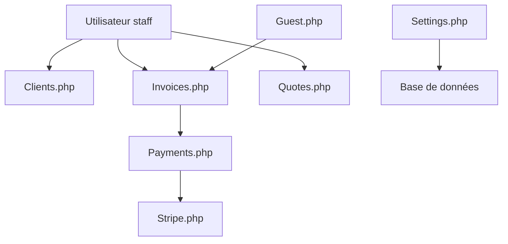

# InvoicePlane/InvoicePlane

> Free, self-hosted web application for invoicing, clients, quotes and payments, for small businesses.

## The problem
Managing invoices, quotes, clients and payments with a self-hosted tool rather than a paid service.

## What it actually does
PHP application (CodeIgniter): invoices and quotes, clients, products, projects and tasks, payment tracking with gateways (Stripe), reports, custom templates, client portal, SUMEX documents. Installed via Docker or a classic web server.

## How it is wired


## Trying it
```bash
git clone https://github.com/InvoicePlane/InvoicePlane.git
cd InvoicePlane
docker compose up -d --build
```

## Cost and gotchas
Free. The `compose.yml` is for development only: fixed encryption key and database password. For production, use environment variables or `ipconfig.php`. A license is present but not identified.

## What it is not
Not full accounting software. The README presents no balance sheet or detailed VAT handling.

## Alternatives
No alternative cited in the README.

## For you
Ignore: a business management tool unrelated to data, AI or MLOps work.
