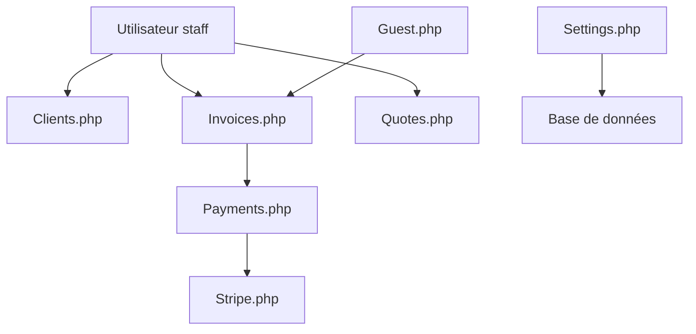

# InvoicePlane/InvoicePlane

> Application web libre et auto-hébergée de facturation, clients, devis et paiements, pour petites structures.

## Le problème
Gérer factures, devis, clients et paiements avec un outil auto-hébergé plutôt qu'un service payant.

## Ce que ça fait vraiment
Application PHP (CodeIgniter) : factures et devis, clients, produits, projets et tâches, suivi des paiements avec passerelles (Stripe), rapports, modèles personnalisés, portail client, documents SUMEX. Installation via Docker ou serveur web classique.

## Comment c'est branché


## Essayer
```bash
git clone https://github.com/InvoicePlane/InvoicePlane.git
cd InvoicePlane
docker compose up -d --build
```

## Coût et pièges
Gratuit. Le `compose.yml` est réservé au développement : clé de chiffrement et mot de passe de base fixes. Pour la production, variables d'environnement ou `ipconfig.php`. Licence présente mais non identifiée.

## Ce que ce n'est pas
Pas un logiciel de comptabilité complet. Le README ne présente pas de bilan ni de TVA détaillée.

## Alternatives
Aucune alternative citée dans le README.

## Pour toi
Ignorer : outil de gestion d'entreprise sans rapport avec un travail data, IA ou MLOps.

