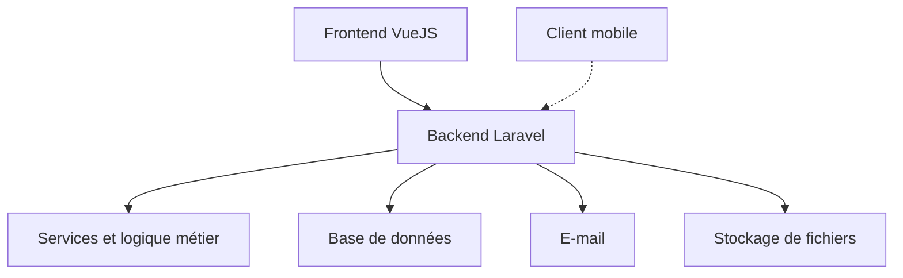

# InvoiceShelf/InvoiceShelf

> Self-hosted invoicing web application for freelancers and small businesses.

## The problem
Invoice and track payments without entrusting your data to a third-party service.

## What it actually does
Invoices, estimates, payments, expenses, taxes, recurring invoices, client portal, multiple companies with roles. Version 3.x issues EN 16931 e-invoices (ZUGFeRD / Factur-X) through a module, with the Gotenberg PDF driver. Laravel on the server side, Vue on the client side.

## How it is wired


## Trying it
```bash
git clone https://github.com/InvoiceShelf/docker.git invoiceshelf
cd invoiceshelf
cp docker-compose.sqlite.yml docker-compose.yml
docker compose up -d
```

## Cost and gotchas
Free, AGPL-3.0. The default 3.x branch is an alpha preview: use 2.x in production. 3.x requires PHP 8.4 or 8.5.

## What it is not
Not a full accounting package. The React Native mobile app is a separate repository.

## Alternatives
No alternative named in the README.

## For you
Ignore: business management application, unrelated to a data / AI / MLOps profile.
