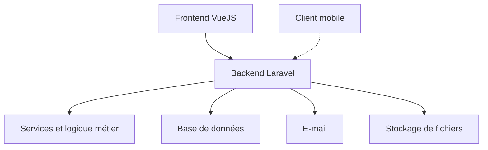

# InvoiceShelf/InvoiceShelf

> Application web auto-hébergée de facturation pour indépendants et petites entreprises.

## Le problème
Facturer et suivre ses paiements sans confier ses données à un service tiers.

## Ce que ça fait vraiment
Factures, devis, paiements, dépenses, taxes, factures récurrentes, portail client, plusieurs sociétés avec rôles. La 3.x émet des e-factures EN 16931 (ZUGFeRD / Factur-X) via un module, avec le pilote PDF Gotenberg. Laravel côté serveur, Vue côté client.

## Comment c'est branché


## Essayer
```bash
git clone https://github.com/InvoiceShelf/docker.git invoiceshelf
cd invoiceshelf
cp docker-compose.sqlite.yml docker-compose.yml
docker compose up -d
```

## Coût et pièges
Gratuit, AGPL-3.0. La branche 3.x par défaut est une préversion alpha : utiliser la 2.x en production. La 3.x exige PHP 8.4 ou 8.5.

## Ce que ce n'est pas
Pas un logiciel comptable complet. Le mobile React Native est un autre dépôt.

## Alternatives
Aucune alternative nommée dans le README.

## Pour toi
À ignorer : application de gestion métier, sans rapport avec un profil data / IA / MLOps.

