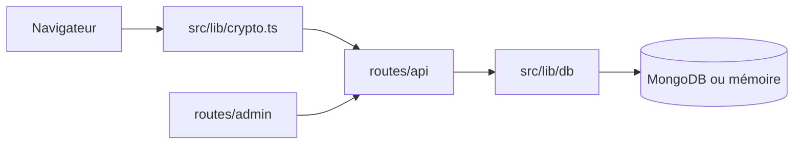

# Ishannaik/CloakBin

> Pastebin encrypted in the browser, where the server only sees ciphertext.

## The problem
Classic pastebins store your secrets in plain text: an admin, a hacker or a stolen database can read them.

## What it actually does
Encrypts with AES-256-GCM in the browser, the key staying in the URL `#` fragment, never sent to the server. Options: password (PBKDF2), burn after reading, expiration, syntax highlighting. Command-line client via npx. Memory or MongoDB storage, admin panel.

## How it is wired


## Trying it
```bash
echo "my-api-key" | npx cloakbin
cp .env.example .env
docker compose up -d
```

## Cost and gotchas
Free to host. You must set `ADMIN_USER`, `ADMIN_PASS` and `ORIGIN`; HTTPS through a reverse proxy is recommended. The author offers a paid deployment service (quote on request).

## What it is not
Not a password vault. Anyone with the full URL can read the content. The command-line client does not yet support member login.

## Alternatives
PrivateBin, cited in the README as an inspiration: it is the well-known reference for this kind of encrypted text sharing. The README names no other alternative.

## For you
Worth watching: handy for sharing an API key ephemerally, but there is a single maintainer.
