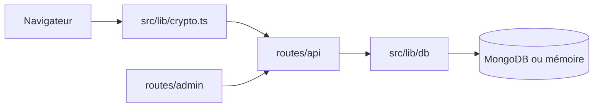

# Ishannaik/CloakBin

> Pastebin chiffré dans le navigateur, où le serveur ne voit que du texte chiffré.

## Le problème
Les pastebins classiques stockent tes secrets en clair : admin, pirate ou base volée les lisent.

## Ce que ça fait vraiment
Chiffre en AES-256-GCM dans le navigateur, la clé restant dans le fragment `#` de l'URL, jamais envoyé au serveur. Options : mot de passe (PBKDF2), destruction après lecture, expiration, coloration syntaxique. Client en ligne de commande via npx. Stockage mémoire ou MongoDB, panneau d'admin.

## Comment c'est branché


## Essayer
```bash
echo "my-api-key" | npx cloakbin
cp .env.example .env
docker compose up -d
```

## Coût et pièges
Gratuit à héberger. Il faut définir `ADMIN_USER`, `ADMIN_PASS` et `ORIGIN` ; HTTPS via proxy inverse conseillé. L'auteur propose un déploiement payant (devis).

## Ce que ce n'est pas
Pas un coffre de mots de passe. Quiconque a l'URL complète lit le contenu. Le client en ligne de commande ne gère pas encore la connexion membre.

## Alternatives
PrivateBin, cité dans le README comme inspiration : c'est la référence connue de ce type de partage chiffré de texte. Le README ne nomme pas d'autre alternative.

## Pour toi
À surveiller : pratique pour partager une clé d'API de façon éphémère, mais un seul mainteneur.

