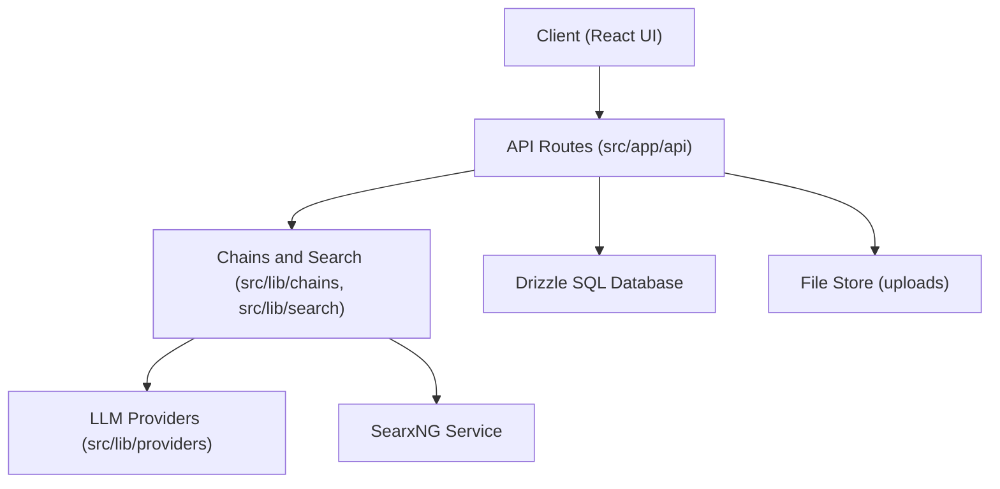

# ItzCrazyKns/Perplexica

> Self-hosted AI answer engine, with cited sources, local or cloud models and search through SearxNG.

## The problem
Commercial AI answer engines send your queries to a third party. Here the search stays on your machine.

## What it actually does
The README (renamed Vane) describes: Speed, Balanced and Quality modes, web sources, discussions and academic papers, widgets (weather, calculations, stock market), image and video search, file upload, local history, a Discover feed.

A request goes through the Next.js API, a search chain queries SearxNG, a model provider (Ollama, OpenAI, Claude, Groq, Gemini) writes the answer with citations. History is stored in a SQL database via Drizzle. The provided diagram comes from a generated description, older than the current README.

## How it is wired


## Trying it
```bash
docker run -d -p 3000:3000 -v vane-data:/home/vane/data --name vane itzcrazykns1337/vane:latest
```
Then open http://localhost:3000 and configure keys and models. Variant with your own SearxNG: image `itzcrazykns1337/vane:slim-latest` and `SEARXNG_API_URL`.

## Cost and gotchas
Docker required; API keys at your expense unless you use a local Ollama model. An external SearxNG instance must enable the JSON format and Wolfram Alpha. Connecting to Ollama from Docker requires a URL setting.

## What it is not
Not multi-user authentication: it is listed among upcoming features. The project was renamed Vane; the ItzCrazyKns/Vane repository presents the same content.

## Alternatives
No alternative named in the README.

## For you
A good testbed for private augmented search with Ollama, but a single maintainer and a duplicate entry of Vane: keep an eye on it.
