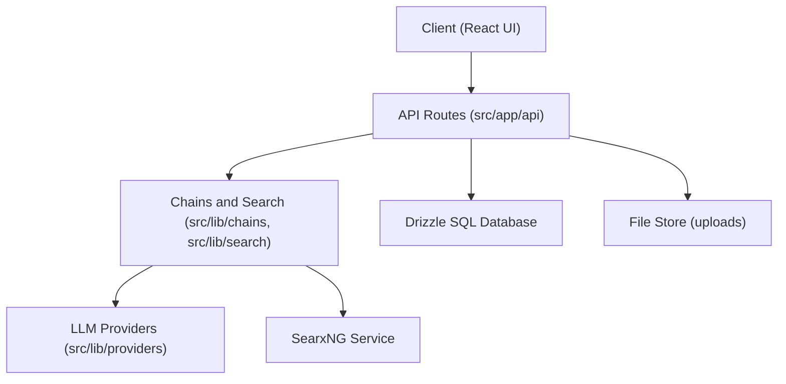

# ItzCrazyKns/Perplexica

> Moteur de réponse IA auto-hébergé, avec sources citées, modèles locaux ou cloud et recherche via SearxNG.

## Le problème
Les moteurs de réponse IA du commerce envoient tes requêtes chez un tiers. Ici la recherche reste sur ta machine.

## Ce que ce n'est pas encore décrit : voir plus bas
Le README (rebaptisé Vane) décrit : modes Vitesse, Équilibré et Qualité, sources web, discussions et articles académiques, widgets (météo, calculs, bourse), recherche d'images et vidéos, upload de fichiers, historique local, flux Discover.

## Ce que ça fait vraiment
Une requête passe par l'API Next.js, une chaîne de recherche interroge SearxNG, un fournisseur de modèle (Ollama, OpenAI, Claude, Groq, Gemini) rédige la réponse avec citations. L'historique est stocké en base SQL via Drizzle. Le diagramme fourni vient d'une description générée, plus ancienne que le README actuel.

## Comment c'est branché


## Essayer
```bash
docker run -d -p 3000:3000 -v vane-data:/home/vane/data --name vane itzcrazykns1337/vane:latest
```
Puis ouvrir http://localhost:3000 et configurer clés et modèles. Variante avec son propre SearxNG : image `itzcrazykns1337/vane:slim-latest` et `SEARXNG_API_URL`.

## Coût et pièges
Docker requis ; clés d'API à ta charge sauf modèle local Ollama. Une instance SearxNG externe doit activer le format JSON et Wolfram Alpha. Les connexions Ollama depuis Docker demandent un réglage d'URL.

## Ce que ce n'est pas
Pas une authentification multi-utilisateurs : elle figure dans les fonctions à venir. Le projet a été renommé Vane ; le dépôt ItzCrazyKns/Vane présente le même contenu.

## Alternatives
Aucune alternative nommée dans le README.

## Pour toi
Bon banc d'essai d'une recherche augmentée privée avec Ollama, mais mainteneur unique et fiche en doublon de Vane : à surveiller.

