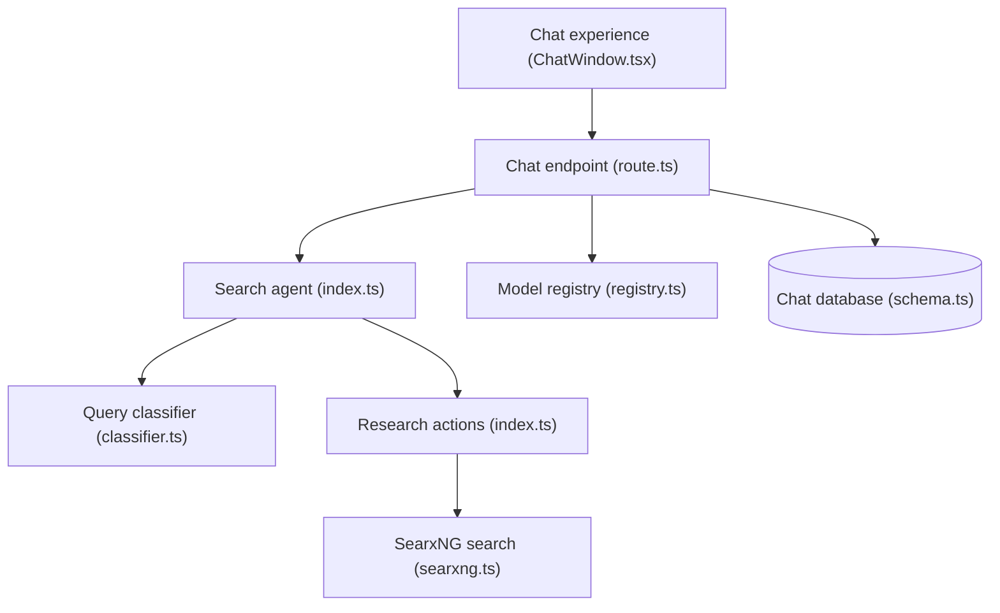

# ItzCrazyKns/Vane

> Self-hosted AI answer engine: web search via SearxNG, local or cloud models, sourced answers.

## The problem
Getting sourced AI answers without entrusting your searches to a third-party service.

## What it actually does
The user asks a question in the interface; the chat API loads the configured models, runs the search (web, discussions, academic, uploaded files) and streams the answer. It adds image and video search, widgets, suggestions, Discover and a local history in a database. The code contains a query classifier and search actions.

## How it is wired


## Trying it
```bash
docker run -d -p 3000:3000 -v vane-data:/home/vane/data --name vane itzcrazykns1337/vane:latest
git clone https://github.com/ItzCrazyKns/Vane.git
cd Vane
npm i
npm run build
npm run start
```
The non-Docker route assumes a SearxNG already installed with the JSON format enabled.

## Cost and gotchas
Docker recommended. Provider API keys are on you, except for local Ollama or Lemonade. Wolfram Alpha must be enabled in SearxNG.

## What it is not
Not a multi-user product: authentication is announced as coming. This repo and ItzCrazyKns/Perplexica show the same README.

## Alternatives
None named in the README.

## For you
Useful for experimenting with a private retrieval-augmented search pipeline with Ollama, but single maintainer and no authentication: keep an eye on it.
