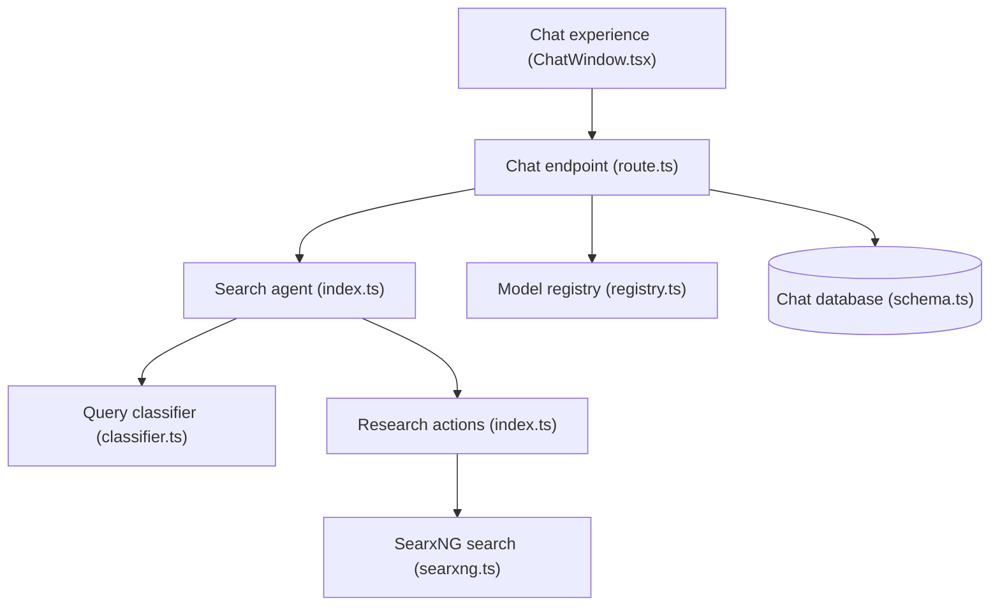

# ItzCrazyKns/Vane

> Moteur de réponse IA auto-hébergé : recherche web via SearxNG, modèles locaux ou cloud, réponses sourcées.

## Le problème
Obtenir des réponses IA sourcées sans confier ses recherches à un service tiers.

## Ce que ça fait vraiment
L'utilisateur pose une question dans l'interface ; l'API de chat charge les modèles configurés, lance la recherche (web, discussions, académique, fichiers téléversés) et diffuse la réponse en continu. S'y ajoutent recherche d'images et vidéos, widgets, suggestions, Discover et historique local en base. Le code contient un classifieur de requêtes et des actions de recherche.

## Comment c'est branché


## Essayer
```bash
docker run -d -p 3000:3000 -v vane-data:/home/vane/data --name vane itzcrazykns1337/vane:latest
git clone https://github.com/ItzCrazyKns/Vane.git
cd Vane
npm i
npm run build
npm run start
```
Le sans-Docker suppose un SearxNG déjà installé avec le format JSON activé.

## Coût et pièges
Docker conseillé. Clés d'API des fournisseurs à ta charge, sauf Ollama ou Lemonade en local. Wolfram Alpha doit être actif dans SearxNG.

## Ce que ce n'est pas
Pas un produit multi-utilisateur : l'authentification est annoncée comme à venir. Ce dépôt et ItzCrazyKns/Perplexica affichent le même README.

## Alternatives
Aucune alternative nommée dans le README.

## Pour toi
Utile pour expérimenter un pipeline de recherche augmentée privé avec Ollama, mais mainteneur unique et sans authentification : à surveiller.

