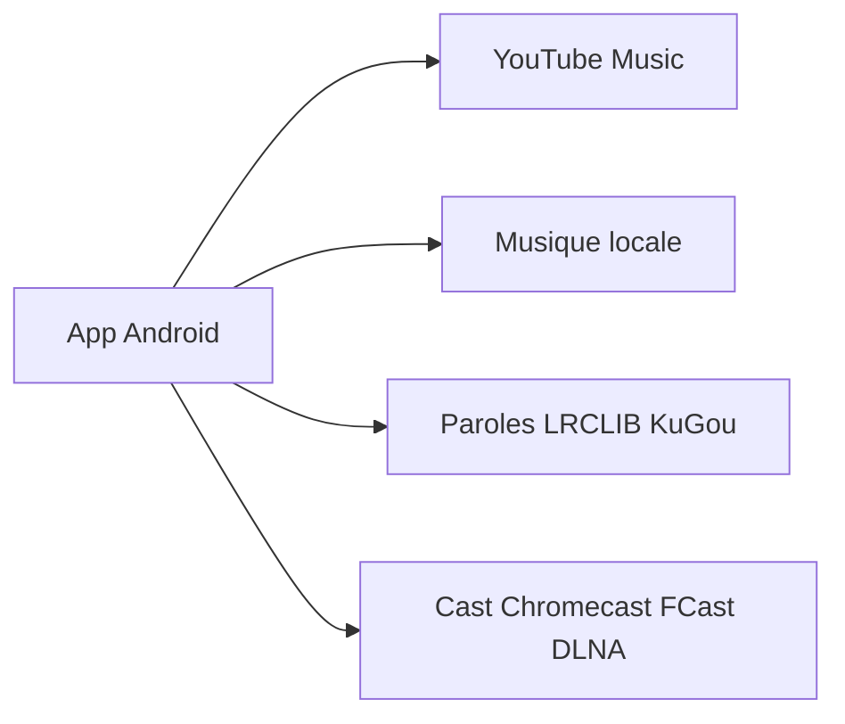

# ItzSkyeYT/InterTune

> Free Android client for YouTube Music that also mixes in the phone's local music.

## The problem
Official clients mix in ads, tracking and separate queues for online and local music.

## What it actually does
YouTube Music and local file playback in a single queue, recommendations computed on the phone, ten-band equalizer, spatial audio, synced lyrics, song recognition via Shazam, playlist import, casting to Chromecast, FCast and DLNA, Android Auto. No ads or tracking; crash reports and install counter only with consent.

## How it is wired
Simplified diagram based on the sheet, no diagram provided.



## Trying it
```bash
git clone --recurse-submodules https://github.com/ItzSkyeYT/InterTune.git
cd InterTune
./gradlew assembleCoreDebug
```

## Cost and gotchas
Free. Build: JDK 21, Android SDK 36, NDK 29 and cmake; the submodules are mandatory. A linked YouTube account may be restricted.

## What it is not
Not the "InterTune" app from the Play Store, which is a different application with ads. It relies on the unofficial workings of YouTube, which can break playback.

## Alternatives
- OuterTune: the fork InterTune derives from.
- Metrolist: source of inspiration cited by the README.

## For you
Ignore: mainstream music player with no link to data, AI or MLOps.
