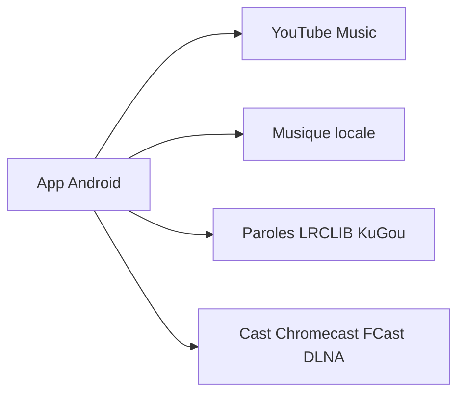

# ItzSkyeYT/InterTune

> Client Android libre pour YouTube Music qui mêle aussi la musique locale du téléphone.

## Le problème
Les clients officiels mélangent publicité, suivi et files séparées pour la musique en ligne et locale.

## Ce que ça fait vraiment
Lecture YouTube Music et fichiers locaux dans une même file, recommandations calculées sur le téléphone, égaliseur dix bandes, audio spatial, paroles synchronisées, reconnaissance de morceaux via Shazam, import de playlists, cast vers Chromecast, FCast et DLNA, Android Auto. Pas de pub ni de suivi ; rapports de plantage et compteur d'installation seulement sur accord.

## Comment c'est branché
Schéma simplifié d'après la fiche, sans diagramme fourni.



## Essayer
```bash
git clone --recurse-submodules https://github.com/ItzSkyeYT/InterTune.git
cd InterTune
./gradlew assembleCoreDebug
```

## Coût et pièges
Gratuit. Compilation : JDK 21, SDK Android 36, NDK 29 et cmake ; les sous-modules sont obligatoires. Un compte YouTube lié peut être restreint.

## Ce que ce n'est pas
Pas l'app « InterTune » du Play Store, qui est une autre application avec pubs. Il dépend du fonctionnement non officiel de YouTube, qui peut casser la lecture.

## Alternatives
- OuterTune : le fork dont InterTune dérive.
- Metrolist : source d'inspiration citée par le README.

## Pour toi
Ignorer : lecteur de musique grand public sans lien avec la data, l'IA ou le MLOps.

