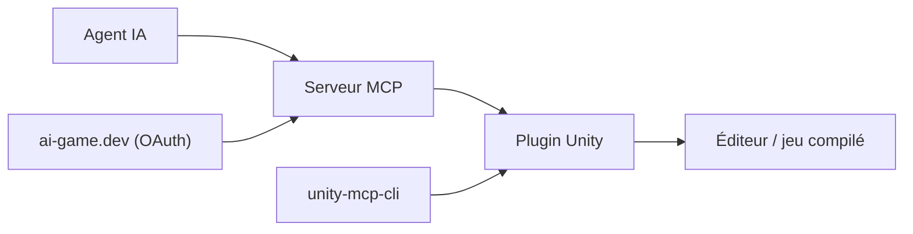

# IvanMurzak/Unity-MCP

> MCP bridge between AI agents (Claude, Cursor, Copilot) and the Unity editor, including in a compiled game.

## The problem
An agent can neither see nor modify the scene, assets and scripts of a Unity project.

## What it actually does
A Unity plugin plus an MCP server (binaries, Docker, stdio or HTTP) with more than 70 tools: assets, GameObjects, scenes, scripts compiled with Roslyn, tests, screenshots, C# reflection. It generates skills according to the Unity version. It lets you add your own tools in C# and call an LLM in the game at runtime.

## How it is wired


## Trying it
```bash
npm install -g unity-mcp-cli
unity-mcp-cli install-plugin ./MyUnityProject
unity-mcp-cli login
unity-mcp-cli open ./MyUnityProject
```

## Cost and gotchas
The project path must not contain spaces. The login step goes through ai-game.dev (OAuth), unless configured locally.

## What it is not
Not a game generator: the agent acts through tools, and results depend on the model. The remote mode depends on the ai-game.dev service.

## Alternatives
No alternative named in the README.

## For you
Worth watching: useful if you work with Unity, otherwise irrelevant; the in-game MCP example is the idea to keep.
