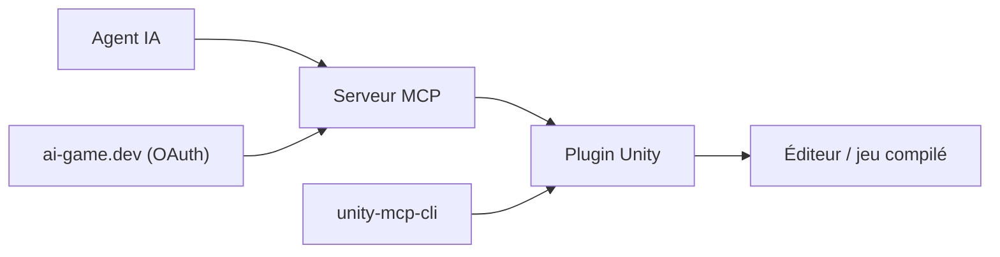

# IvanMurzak/Unity-MCP

> Pont MCP entre agents IA (Claude, Cursor, Copilot) et l'éditeur Unity, y compris en jeu compilé.

## Le problème
Un agent ne voit ni ne modifie scène, assets et scripts d'un projet Unity.

## Ce que ça fait vraiment
Plugin Unity plus serveur MCP (binaires, Docker, stdio ou HTTP) avec plus de 70 outils : assets, GameObjects, scènes, scripts compilés avec Roslyn, tests, captures, réflexion C#. Il génère des skills selon la version d'Unity. Il permet d'ajouter ses propres outils en C# et d'appeler un LLM dans le jeu à l'exécution.

## Comment c'est branché


## Essayer
```bash
npm install -g unity-mcp-cli
unity-mcp-cli install-plugin ./MyUnityProject
unity-mcp-cli login
unity-mcp-cli open ./MyUnityProject
```

## Coût et pièges
Le chemin du projet ne doit pas contenir d'espaces. L'étape de connexion passe par ai-game.dev (OAuth), sauf configuration locale.

## Ce que ce n'est pas
Pas un générateur de jeu : l'agent agit via des outils, les résultats dépendent du modèle. Le mode distant dépend du service ai-game.dev.

## Alternatives
Aucune alternative nommée dans le README.

## Pour toi
À surveiller : utile si tu touches Unity, sinon sans objet ; l'exemple MCP en jeu est l'idée à retenir.

