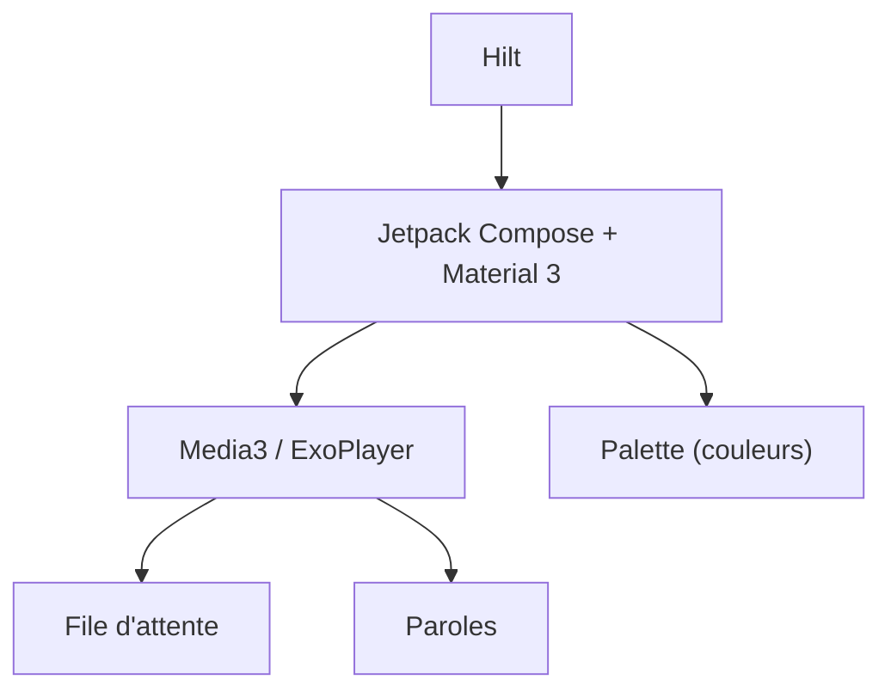

# JAY01-CYBER/M3-Play

> Android music player in Compose and Media3, derived from ArchiveTune, for customization enthusiasts.

## The problem
The README says nothing about the problem addressed: only "a fast and customizable player". Insufficient material.

## What it actually does
- Playback via Media3 / ExoPlayer, "smart" queue, lyrics.
- Dynamic colors drawn from the cover art, interface styles, pure black mode, haptic feedback.
- The README announces a download section and screenshots, but with no content here.

## How it is wired
Simplified diagram based on the sheet, no diagram provided.

## Trying it
No command documented in the README ("Download & Install" section empty here).

## Cost and gotchas
Free, according to the README. Installation and build procedure not documented. Derived from another project (ArchiveTune): trace the code's lineage before any use.

## What it is not
Not a documented project: no information on the source of tracks, permissions or limits. GPL-3.0 license.

## Alternatives
No alternative cited, apart from ArchiveTune, from which the project originates.

## For you
Ignore: Android app outside your scope, and a README too thin to judge quality.
