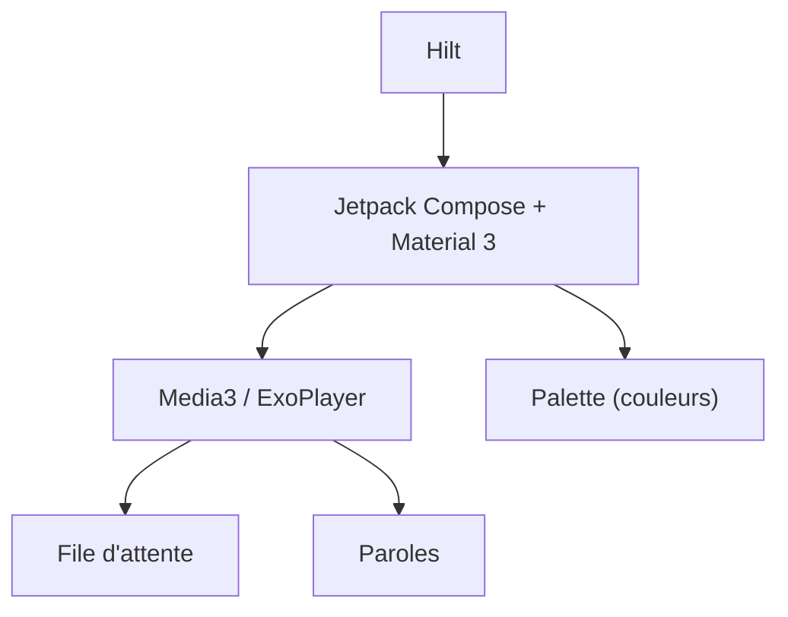

# JAY01-CYBER/M3-Play

> Lecteur de musique Android en Compose et Media3, dérivé d'ArchiveTune, pour amateurs de personnalisation.

## Le problème
Le README ne dit rien du problème traité : seulement « un lecteur rapide et personnalisable ». Matière insuffisante.

## Ce que ça fait vraiment
- Lecture via Media3 / ExoPlayer, file d'attente « intelligente », paroles.
- Couleurs dynamiques tirées de la pochette, styles d'interface, mode noir pur, retour haptique.
- Le README annonce une section de téléchargement et des captures, mais sans contenu ici.

## Comment c'est branché
Schéma simplifié d'après la fiche, sans diagramme fourni.

## Essayer
Aucune commande documentée dans le README (section « Download & Install » vide ici).

## Coût et pièges
Gratuit, selon le README. Procédure d'installation et de compilation non documentées. Dérivé d'un autre projet (ArchiveTune) : suivre la lignée du code avant tout usage.

## Ce que ce n'est pas
Pas un projet documenté : aucune information sur la source des morceaux, les permissions ou les limites. Licence GPL-3.0.

## Alternatives
Aucune alternative citée, à part ArchiveTune, dont le projet est issu.

## Pour toi
À ignorer : app Android hors périmètre, et un README trop mince pour juger la qualité.

