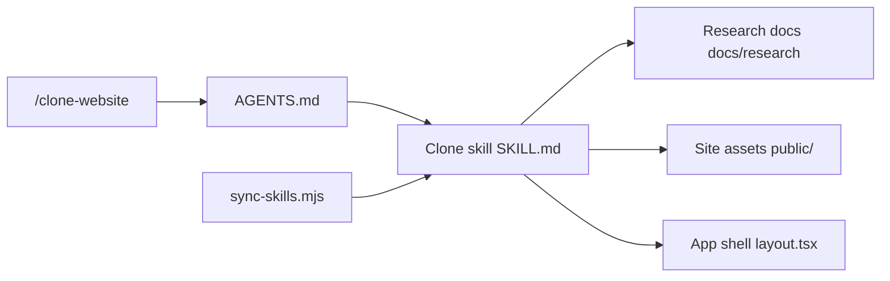

# JCodesMore/ai-website-cloner-template

> Next.js project template where a coding agent recreates a site from a URL.

## The problem
Rebuilding an existing site (migration, lost source code) by hand is long and tedious.

## What it actually does
A Next.js 16 / React 19 / Tailwind v4 / shadcn template with a `/clone-website <url>` command. The agent follows four steps: map, observe (desktop/mobile pages, assets, fonts), build components, compare with the source. Agent instructions are synced to ten environments (Claude, Codex, Cursor, OpenCode…) from `AGENTS.md` and a skill.

## How it is wired


## Trying it
```bash
npm run dev
npm run check
docker compose up app --build
```

## Cost and gotchas
Node 24+ and a coding agent with browser access; the best results are advertised with Claude Code and a top-tier model (hence paid at your expense).

## What it is not
Not a neutral scraping tool: the README rules out phishing, impersonation and terms-of-service violations. Logos, texts and brands remain the property of the copied sites.

## Alternatives
No alternative named in the README.

## For you
Worth ignoring for a data/AI profile: front-end oriented use, legal risk on copied content, no link with data pipelines.
