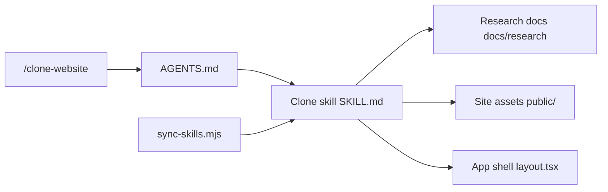

# JCodesMore/ai-website-cloner-template

> Modèle de projet Next.js où un agent de code recrée un site à partir d'une URL.

## Le problème
Refaire un site existant (migration, code source perdu) à la main est long et fastidieux.

## Ce que ça fait vraiment
Un gabarit Next.js 16 / React 19 / Tailwind v4 / shadcn avec une commande `/clone-website <url>`. L'agent suit quatre étapes : cartographier, observer (pages desktop/mobile, assets, polices), construire des composants, comparer avec la source. Les consignes d'agent sont synchronisées vers dix environnements (Claude, Codex, Cursor, OpenCode…) à partir de `AGENTS.md` et d'un skill.

## Comment c'est branché


## Essayer
```bash
npm run dev
npm run check
docker compose up app --build
```

## Coût et pièges
Node 24+ et un agent de code avec accès navigateur ; les meilleurs résultats sont annoncés avec Claude Code et un modèle de niveau supérieur (donc payant à ta charge).

## Ce que ce n'est pas
Pas un outil de scraping neutre : le README exclut le hameçonnage, l'usurpation et la violation de conditions d'utilisation. Les logos, textes et marques restent la propriété des sites copiés.

## Alternatives
Aucune alternative nommée dans le README.

## Pour toi
À ignorer pour un profil data/IA : usage orienté front-end, risque juridique sur les contenus copiés, aucun lien avec les pipelines data.

