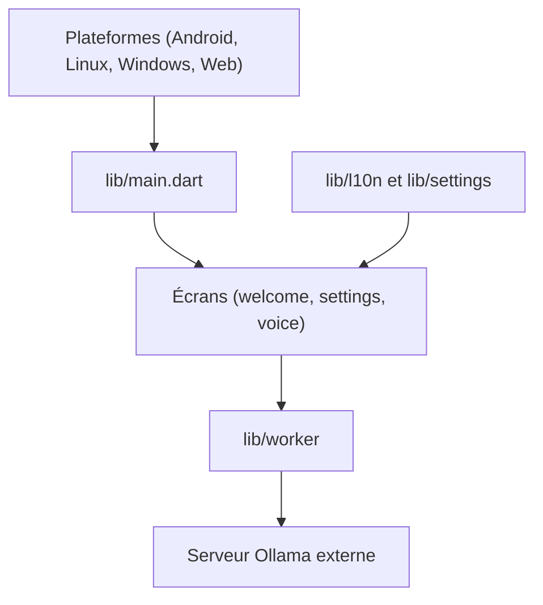

# JHubi1/ollama-app

> A cross-platform Flutter client for chatting with an Ollama server on your local network.

## The problem
Ollama exposes an API but no mobile interface: chatting with a local model from a phone requires a dedicated client.

## What it actually does
A Flutter application (Android, Linux, Windows, web) that connects to the API of an existing Ollama server. It hosts no model. It offers chat, settings, localization and an experimental voice mode. Desktop support is experimental, the Windows installer is unsigned.

## How it is wired
Simplified diagram based on the code's diagram.



## Trying it
```bash
# Linux, depuis le dossier extrait de la release
./ollama
```

## Cost and gotchas
Free, but you already need a reachable Ollama server; setting up the host is the hard part. On Linux, the GTK library may be missing.

## What it is not
It is not an Ollama server: it runs no model on the device. Desktop remains experimental.

## Alternatives
No alternative named in the README.

## For you
Worth watching: handy if you host Ollama at home and want to query it from a phone, with no API key or cloud.
