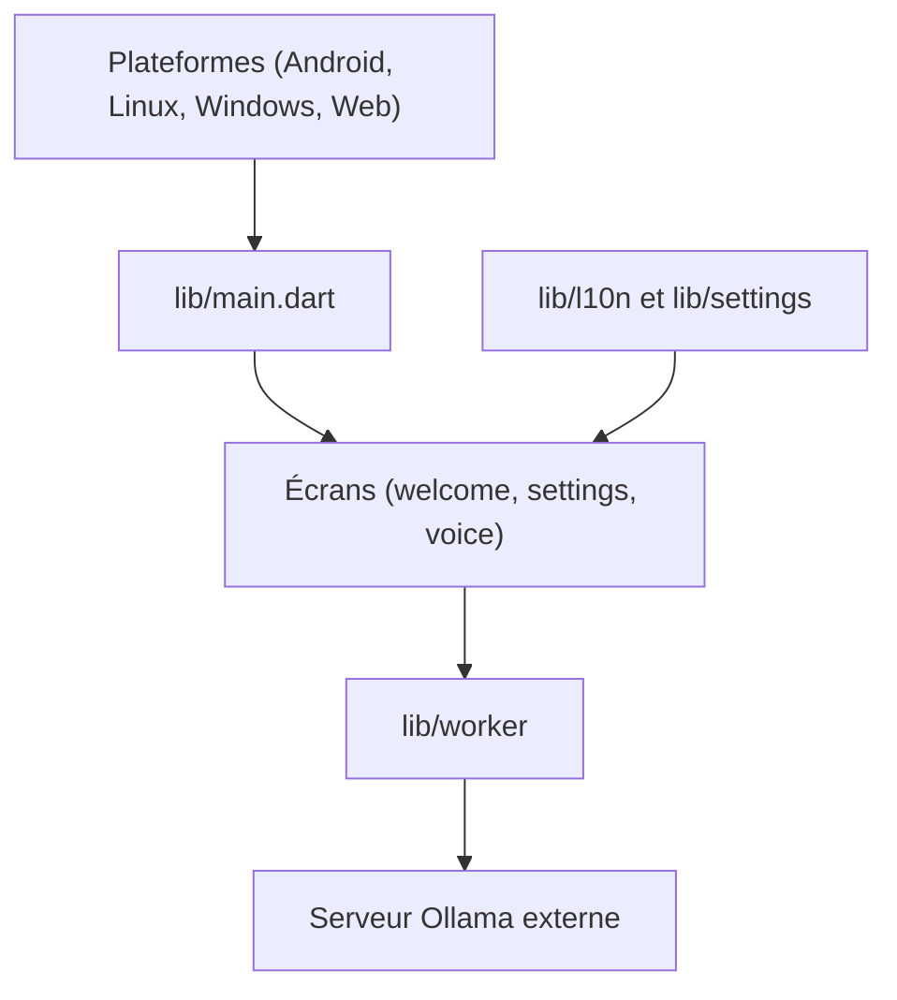

# JHubi1/ollama-app

> Client Flutter multiplateforme pour discuter avec un serveur Ollama de ton réseau local.

## Le problème
Ollama expose une API mais pas d'interface mobile : discuter avec un modèle local depuis un téléphone demande un client dédié.

## Ce que ça fait vraiment
Une application Flutter (Android, Linux, Windows, web) qui se connecte à l'API d'un serveur Ollama existant. Elle n'héberge aucun modèle. Elle propose le chat, des réglages, la localisation et un mode vocal expérimental. Le support bureau est expérimental, l'installateur Windows n'est pas signé.

## Comment c'est branché
Schéma simplifié d'après le diagramme du code.



## Essayer
```bash
# Linux, depuis le dossier extrait de la release
./ollama
```

## Coût et pièges
Gratuit, mais il faut déjà un serveur Ollama joignable ; la mise en place de l'hôte est la partie difficile. Sous Linux, la bibliothèque GTK peut manquer.

## Ce que ce n'est pas
Ce n'est pas un serveur Ollama : il ne fait tourner aucun modèle sur l'appareil. Le bureau reste expérimental.

## Alternatives
Aucune alternative nommée dans le README.

## Pour toi
À surveiller : pratique si tu héberges Ollama chez toi et veux l'interroger depuis un téléphone, sans clé d'API ni cloud.

