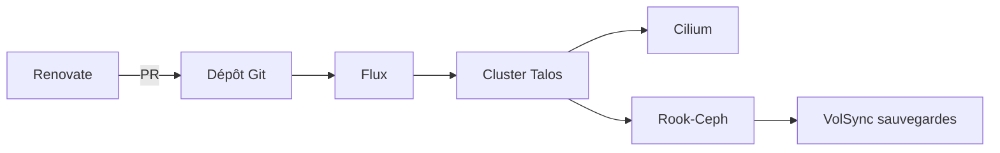

# JJGadgets/Biohazard

> GitOps monorepo of a Kubernetes homelab running Talos, Flux and Cilium, to be read as a configuration example.

## The problem
Maintaining a home cluster by hand makes changes risky and hard to reproduce.

## What it actually does
The repository describes a home production cluster: Talos, Flux and Renovate for GitOps, Cilium for networking, Rook-Ceph and VolSync for storage and backups, KubeVirt for VMs, external-secrets, cert-manager and VictoriaMetrics. The core components are under `./kube/deploy/core`. The "Overview" part of the README is commented out.

## How it is wired
Simplified diagram based on the fiche, no diagram provided.

## Trying it
No command documented in the README.

## Cost and gotchas
Personal hardware and network, and a lot of RAM for Ceph. Secrets via 1Password, DNS and tunnel via Cloudflare. It is not designed to be cloned as is.

## What it is not
It is not an installable product: it is an author's personal configuration, which the author himself calls "jank".

## Alternatives
No alternative named in the README.

## For you
Watch: a good mine of Flux and Kubernetes examples for MLOps, to pick from rather than adopt.
