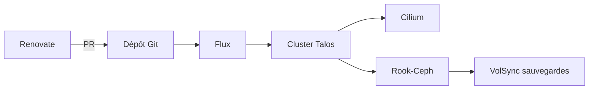

# JJGadgets/Biohazard

> Monorepo GitOps d'un homelab Kubernetes sous Talos, Flux et Cilium, à lire comme exemple de configuration.

## Le problème
Maintenir à la main un cluster domestique rend les changements risqués et peu reproductibles.

## Ce que ça fait vraiment
Le dépôt décrit un cluster de production domestique : Talos, Flux et Renovate pour le GitOps, Cilium pour le réseau, Rook-Ceph et VolSync pour le stockage et les sauvegardes, KubeVirt pour des VM, external-secrets, cert-manager et VictoriaMetrics. Les composants cœur sont sous `./kube/deploy/core`. La partie « Overview » du README est commentée.

## Comment c'est branché
Schéma simplifié d'après la fiche, sans diagramme fourni.

## Essayer
Aucune commande documentée dans le README.

## Coût et pièges
Matériel et réseau personnels, et beaucoup de RAM pour Ceph. Secrets via 1Password, DNS et tunnel via Cloudflare. Ce n'est pas conçu pour être cloné tel quel.

## Ce que ce n'est pas
Ce n'est pas un produit installable : c'est la configuration personnelle d'un auteur, qui se qualifie de « jank » lui-même.

## Alternatives
Aucune alternative nommée dans le README.

## Pour toi
Surveiller : bonne mine d'exemples Flux et Kubernetes pour du MLOps, à piocher plutôt qu'à adopter.

