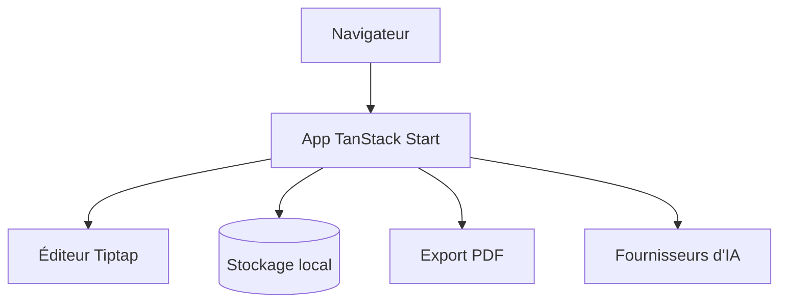

# JOYCEQL/magic-resume

> Online resume editor with live preview, themes and PDF export, for job candidates.

## The problem
Formatting a clean resume requires heavy or paid tools.

## What it actually does
TanStack Start application (TypeScript, Tiptap, Zustand): editing with real-time preview, themes, dark mode, automatic saving to local storage, PDF export. AI providers are configurable (including OrcaRouter via a referral link); a proxy is planned for OpenAI, Gemini and Anthropic.

## How it is wired
No diagram provided.


## Trying it
```bash
git clone git@github.com:JOYCEQL/magic-resume.git
cd magic-resume
pnpm install
pnpm dev
docker compose up -d
```

## Cost and gotchas
Free; the AI features use your key or a provider account. The OrcaRouter link is a commercial referral.

## What it is not
Not a data/AI tool: a resume app. A license is present but not identified.

## Alternatives
None named in the README.

## For you
Ignore: unrelated to data or MLOps work, and the license is unclear; useful only for writing your resume.
