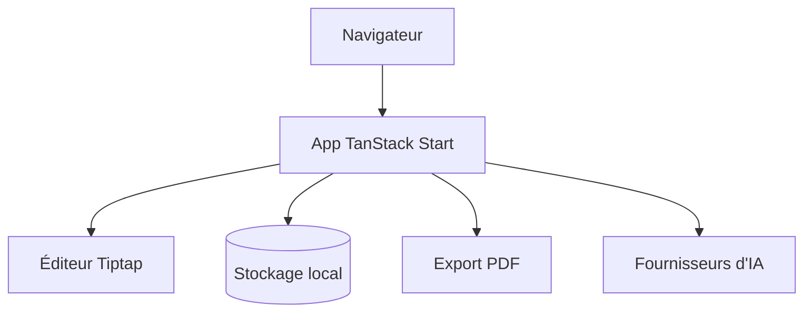

# JOYCEQL/magic-resume

> Éditeur de CV en ligne avec aperçu en direct, thèmes et export PDF, pour candidats.

## Le problème
Mettre en forme un CV propre demande des outils lourds ou payants.

## Ce que ça fait vraiment
Application TanStack Start (TypeScript, Tiptap, Zustand) : édition avec aperçu en temps réel, thèmes, mode sombre, sauvegarde automatique en stockage local, export PDF. Des fournisseurs d'IA sont configurables (dont OrcaRouter via lien de parrainage) ; un proxy est prévu pour OpenAI, Gemini et Anthropic.

## Comment c'est branché
Pas de diagramme fourni.


## Essayer
```bash
git clone git@github.com:JOYCEQL/magic-resume.git
cd magic-resume
pnpm install
pnpm dev
docker compose up -d
```

## Coût et pièges
Gratuit ; les fonctions IA utilisent ta clé ou un compte fournisseur. Le lien OrcaRouter est un parrainage commercial.

## Ce que ce n'est pas
Pas un outil data/IA : une appli de CV. Licence présente mais non identifiée.

## Alternatives
Aucune nommée dans le README.

## Pour toi
Ignorer : sans lien avec un travail data ou MLOps, et licence floue ; utile seulement pour rédiger ton CV.

