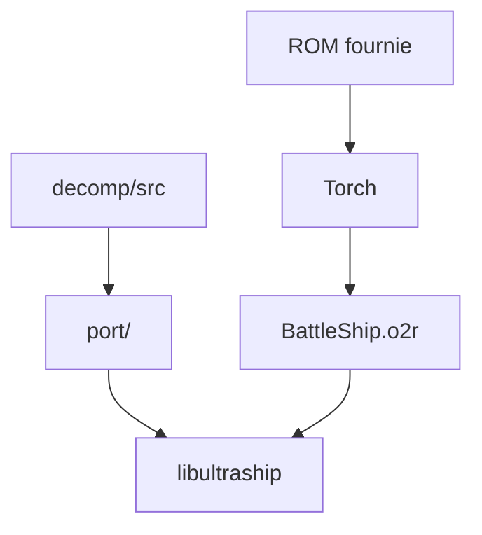

# JRickey/BattleShip

> PC port of Super Smash Bros. N64, built on a decompilation and a ROM that you provide.

## The problem
The N64 game only runs on the console or an emulator, without modern resolution, controller support or mods.

## What it actually does
- Decompiled C code, a C++ porting layer and libultraship for rendering, audio and input.
- Torch extracts the assets from your ROM at build time into `BattleShip.o2r`; no Nintendo file is distributed.
- Options: widescreen, texture packs, co-op in Classic mode, mods in C, rollback in progress.
- Runs on macOS, Linux, Windows and Android.

## How it is wired

## Trying it
The README points to `BUILDING.md`; the only command cited is the CMake option `-DSSB64_VERSION=us|jp`.

## Cost and gotchas
Free, but a legal Smash Bros. ROM is essential, with the SHA-1 fingerprints given. License not identified by GitHub; the upstream decompilation has no explicit license.

## What it is not
Not a ready-to-run game: nothing is provided, you compile it yourself. A fan project unrelated to Nintendo, partly designed with an AI.

## Alternatives
No alternative named in the README, apart from ports of the same family (Ship of Harkinian, Starship, SpaghettiKart).

## For you
Ignore: a game port, unrelated to data, AI or MLOps work, with an unclear license status.
