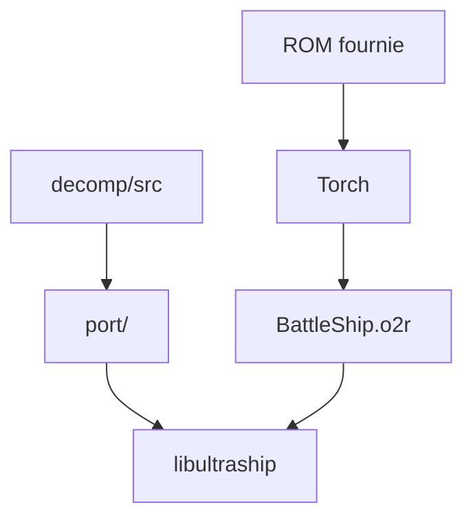

# JRickey/BattleShip

> Portage PC de Super Smash Bros. N64, construit sur une décompilation et une ROM que tu fournis.

## Le problème
Le jeu N64 ne tourne que sur la console ou un émulateur, sans résolution, manette ni mods modernes.

## Ce que ça fait vraiment
- Code C décompilé, couche C++ de portage et libultraship pour le rendu, l'audio et les entrées.
- Torch extrait les ressources de ta ROM à la compilation en `BattleShip.o2r` ; aucun fichier Nintendo n'est distribué.
- Options : écran large, packs de textures, co-op en mode Classic, mods en C, rollback en cours.
- Tourne sur macOS, Linux, Windows et Android.

## Comment c'est branché

## Essayer
Le README renvoie à `BUILDING.md` ; la seule commande citée est l'option CMake `-DSSB64_VERSION=us|jp`.

## Coût et pièges
Gratuit, mais une ROM légale de Smash Bros. est indispensable, aux empreintes SHA-1 indiquées. Licence non identifiée par GitHub ; la décompilation amont n'a pas de licence explicite.

## Ce que ce n'est pas
Pas un jeu prêt à lancer : rien n'est fourni, tu compiles toi-même. Projet de fan sans lien avec Nintendo, en partie conçu avec une IA.

## Alternatives
Aucune alternative nommée dans le README, hormis les ports de la même famille (Ship of Harkinian, Starship, SpaghettiKart).

## Pour toi
À ignorer : un portage de jeu, sans rapport avec un travail data, IA ou MLOps, et au statut de licence flou.

