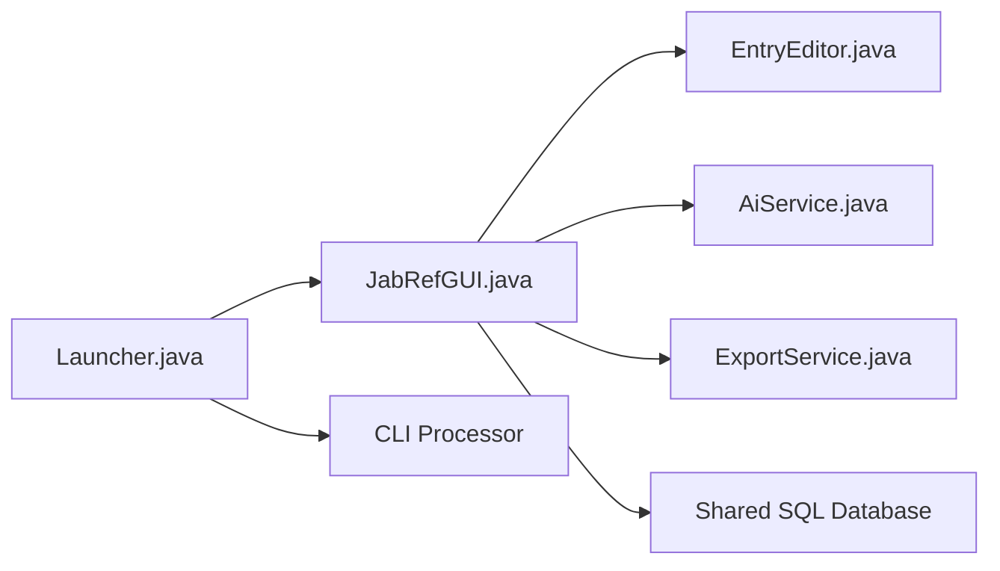

# JabRef/jabref

> Open-source reference manager for researchers working with BibTeX/BibLaTeX.

## The problem
Collecting, organizing and citing scientific sources without losing metadata or files.

## What it actually does
Java desktop application: search across many catalogs (CrossRef, arXiv, PubMed…), import of more than 15 formats, PDF metadata extraction, duplicates, citation keys, groups, renaming of linked files. Citation from Word/LibreOffice and LaTeX editors. Library stored as a text file or shared through an SQL database. AI module (embedding-based search) and BibTeX language server; JabKit CLI.

## How it is wired


## Trying it
```bash
docker run ghcr.io/jabref/jabkit:edge --help
```
(GUI installation: installation guide / GitHub releases.)

## Cost and gotchas
Free. Building from source is documented separately. The AI module depends on a model; the README does not detail which keys to provide.

## What it is not
Not an automated literature review tool: it manages and cites, it does not replace reading.

## Alternatives
No alternative named in the README.

## For you
Adopt if you write papers or reports in LaTeX: actively maintained, open formats, version-controllable.
