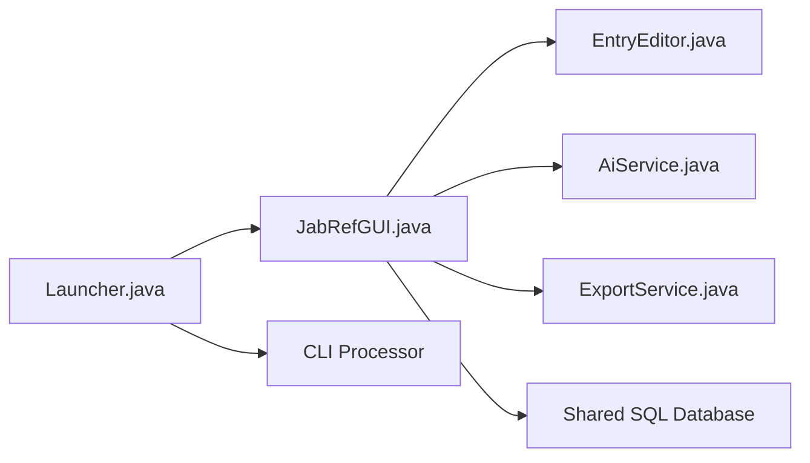

# JabRef/jabref

> Gestionnaire de références bibliographiques open source, pour chercheurs travaillant en BibTeX/BibLaTeX.

## Le problème
Collecter, organiser et citer des sources scientifiques sans perdre de métadonnées ni de fichiers.

## Ce que ça fait vraiment
Application de bureau Java : recherche dans de nombreux catalogues (CrossRef, arXiv, PubMed…), import de plus de 15 formats, extraction de métadonnées de PDF, doublons, clés de citation, groupes, renommage de fichiers liés. Citation depuis Word/LibreOffice et éditeurs LaTeX. Bibliothèque en fichier texte ou partagée via base SQL. Module IA (recherche par embeddings) et serveur de langage BibTeX ; CLI JabKit.

## Comment c'est branché


## Essayer
```bash
docker run ghcr.io/jabref/jabkit:edge --help
```
(Installation du GUI : guide d'installation / releases GitHub.)

## Coût et pièges
Gratuit. Build depuis les sources documenté à part. Le module IA dépend d'un modèle ; le README ne détaille pas les clés à fournir.

## Ce que ce n'est pas
Pas un outil de revue de littérature automatisé : il gère et cite, il ne remplace pas la lecture.

## Alternatives
Aucune alternative nommée dans le README.

## Pour toi
À adopter si tu rédiges des articles ou rapports en LaTeX : maintenu activement, formats ouverts, versionnable.

