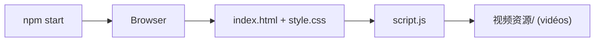

# Jackywine/Bella

> Web prototype of a voice AI companion with animated videos, still largely at the vision stage.

## The problem
Creating a conversational digital companion that listens and expresses emotions.

## What it actually does
The README announces Whisper speech recognition, LLM dialogue, TTS, an affinity system and model downloading. The architecture drawn from the code sees only a static interface: a video carousel and a "favor" bar (index.html, script.js, style.css), with no AI backend. Memory, personality and facial perception are "planned".

## How it is wired


## Trying it
```bash
git clone https://github.com/GRISHM7890/Bella.git
cd Bella
npm install
npm run download
npm start
```

## Cost and gotchas
Node 22.16+, a browser with the Web Speech API, a microphone. Models to download (size not specified). The README clones `GRISHM7890/Bella`, not this repository: inconsistency to check.

## What it is not
Not a working AI companion: the gap between README and code is clear. No license.

## Alternatives
None named in the README.

## For you
Ignore: promises not demonstrated by the code, missing license, inconsistent clone URL.
