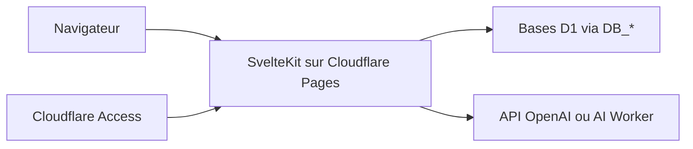

# JacobLinCool/d1-manager

> Web interface and API to manage Cloudflare D1 databases, deployed on Cloudflare Pages.

## The problem
Cloudflare D1 is a serverless SQL database: browsing tables and editing rows requires dedicated tools.

## What it actually does
A SvelteKit application that lists several D1 databases, shows tables and schemas, runs SQL and lets you edit data in the interface. A semantic query translates natural language into SQL through the OpenAI API or a Cloudflare AI Worker. The interface is available in English, Chinese, Spanish and Japanese, and exposes an API (routes/api).

## How it is wired


## Trying it
```bash
npm run build
```
The rest is Cloudflare configuration: fork, Pages project (SvelteKit preset, output `.svelte-kit/cloudflare`), binding the databases to the `DB_*` variables, protection through Cloudflare Access.

## Cost and gotchas
A Cloudflare account is required. The semantic query uses an OpenAI key (`OPENAI_API_KEY`) billed to you, or an AI Worker. Cloudflare Access by default only protects preview pages: you must add the other URLs.

## What it is not
Not a tool for databases other than D1. Not a local application: it only makes sense within the Cloudflare ecosystem.

## Alternatives
None named in the README.

## For you
Watch: useful if your data already lives in D1, otherwise of no interest, and the semantic query sends your schemas to a third-party model.
