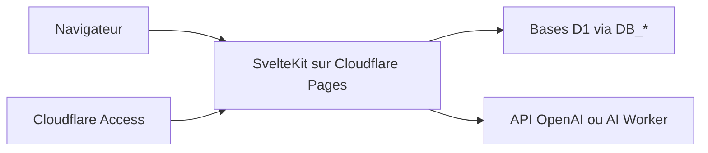

# JacobLinCool/d1-manager

> Interface web et API pour gérer des bases Cloudflare D1, déployée sur Cloudflare Pages.

## Le problème
Cloudflare D1 est une base SQL serverless : consulter les tables et éditer des lignes demande ses propres outils.

## Ce que ça fait vraiment
Une application SvelteKit qui liste plusieurs bases D1, affiche tables et schémas, exécute du SQL et permet d'éditer les données dans l'interface. Une requête sémantique traduit le langage naturel en SQL via l'API OpenAI ou un Cloudflare AI Worker. L'interface existe en anglais, chinois, espagnol et japonais, et expose une API (routes/api).

## Comment c'est branché


## Essayer
```bash
npm run build
```
Le reste est de la configuration Cloudflare : fork, projet Pages (preset SvelteKit, sortie `.svelte-kit/cloudflare`), liaison des bases aux variables `DB_*`, protection par Cloudflare Access.

## Coût et pièges
Compte Cloudflare requis. La requête sémantique utilise une clé OpenAI (`OPENAI_API_KEY`) facturée à ta charge, ou un AI Worker. Cloudflare Access protège par défaut seulement les pages de prévisualisation : il faut ajouter les autres URL.

## Ce que ce n'est pas
Pas un outil pour d'autres bases que D1. Pas une application locale : elle n'a de sens que dans l'écosystème Cloudflare.

## Alternatives
Aucune nommée dans le README.

## Pour toi
À surveiller : utile si tes données vivent déjà dans D1, sinon sans intérêt, et la requête sémantique envoie tes schémas à un modèle tiers.

