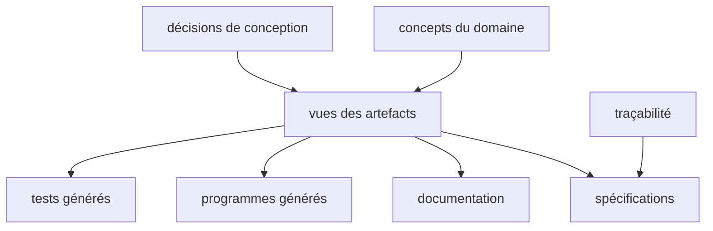

# JacquesCarette/Drasil

> Haskell framework that generates code, specifications and documentation for scientific software from domain knowledge.

## The problem
The artifacts of scientific software (specification, code, tests) duplicate the same knowledge and drift apart over time.

## What it actually does
Captures domain concepts and design decisions, then produces different views: specifications (SRS), documentation, programs and tests, with traceability. Case studies include a pendulum, a projectile trajectory, PD control, slope stability.

## How it is wired


## Trying it
```bash
cd code
stack setup
make
make help
stack exec projectile
```

## Cost and gotchas
A full build takes 10 to 15 minutes (macOS estimate); the Haddock docs 10 to 12 minutes. Stack tools installed beforehand.

## What it is not
Not a universal generator: intended for well-understood scientific domains. The architecture diagram is partly inferred from the README.

## Alternatives
No alternative named.

## For you
Ignore: scientific software engineering research in Haskell, too far from everyday data/AI work.
