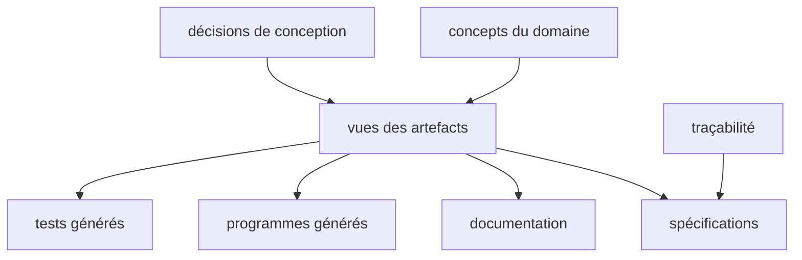

# JacquesCarette/Drasil

> Cadre Haskell qui génère code, spécifications et documentation d'un logiciel scientifique à partir d'un savoir du domaine.

## Le problème
Les artefacts d'un logiciel scientifique (spécification, code, tests) dupliquent la même connaissance et divergent avec le temps.

## Ce que ça fait vraiment
Capture les concepts du domaine et les décisions de conception, puis produit différentes vues : spécifications (SRS), documentation, programmes et tests, avec traçabilité. Les études de cas incluent un pendule, une trajectoire de projectile, une régulation PD, de la stabilité de pente.

## Comment c'est branché


## Essayer
```bash
cd code
stack setup
make
make help
stack exec projectile
```

## Coût et pièges
La construction complète dure 10 à 15 minutes (estimation macOS) ; la doc Haddock 10 à 12 minutes. Outils stack installés au préalable.

## Ce que ce n'est pas
Pas un générateur universel : prévu pour des domaines scientifiques bien compris. Le schéma d'architecture reste en partie déduit du README.

## Alternatives
Aucune alternative nommée.

## Pour toi
À ignorer : recherche en génie logiciel scientifique en Haskell, trop éloignée d'un travail data/IA courant.

