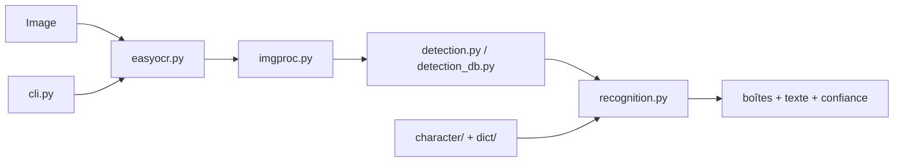

# JaidedAI/EasyOCR

> Python OCR library (text detection then recognition) covering 80+ languages, for data developers.

## The problem
Extracting text from images in varied scripts (Latin, Chinese, Arabic, Cyrillic…) requires assembling a detector, a recognizer and vocabularies yourself.

## What it actually does
Two-stage pipeline: text region detection (CRAFT or DBNet) then CRNN recognition with CTC decoding.
`easyocr.Reader([...])` loads the models once; `readtext()` returns boxes, text and confidence.
Weights are downloaded automatically into `~/.EasyOCR/model`; CPU mode via `gpu=False`.
A `trainer/` subfolder lets you train or fine-tune the detector and recognizer.

## How it is wired


## Trying it
```bash
pip install easyocr
easyocr -l ch_sim en -f chinese.jpg --detail=1 --gpu=True
```

## Cost and gotchas
Free; GPU recommended but optional. On Windows, install torch/torchvision first; some DBNet models require native compilation.

## What it is not
No handwriting (announced as "coming soon"). Not all languages can be combined in a single `Reader`. Issues older than 6 months are closed automatically.

## Alternatives
No alternative named in the README.

## For you
Adopt: it is the easiest multilingual OCR to plug into a Python pipeline, under Apache-2.0, with a training path if your documents are unusual.
