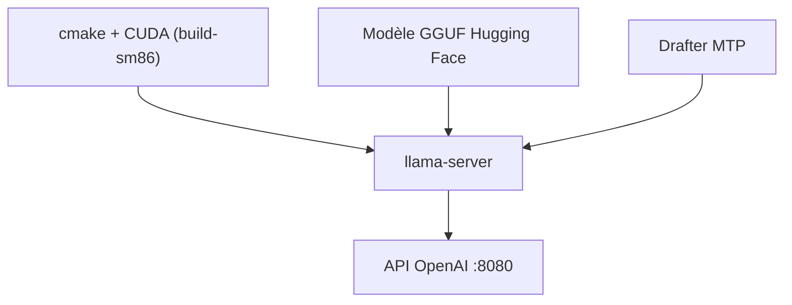

# JakeATX/llamAmpere

> llama.cpp variant optimized for NVIDIA RTX 30 (Ampere) cards, to run Qwen3.8 models locally.

## The problem
Running large models on an RTX 3090 while keeping fast generation and long context remains hard with generic builds.

## What it actually does
Fork of `llama.cpp` with speculative decoding (MTP head, DFlash2 drafter), KV cache quantization (SJ-KVaRN) and its own weight formats. Supports Qwen3.8 27B and Flash-Next, whose experts are split between card and RAM. The server exposes an OpenAI-compatible API on `127.0.0.1:8080`. Speed figures are measurements by the author or contributors, often on a single card.

## How it is wired
Simplified diagram based on the sheet, no diagram provided.



## Trying it
```bash
git clone -b v0.6.4 https://github.com/JakeATX/llamAmpere.git
cd llamAmpere
cmake -S . -B build-sm86 -DCMAKE_BUILD_TYPE=Release -DGGML_CUDA=ON -DCMAKE_CUDA_ARCHITECTURES=86 -DLLAMA_BUILD_BORINGSSL=ON
cmake --build build-sm86 -j8 --target llama-server
```

## Cost and gotchas
CUDA 12+ toolkit, CMake and a C++ compiler; the Flash-Next model weighs 81.63 GB and requires a lot of system RAM. Flash-Next cannot be split across two cards. Windows support comes from contributions untested by the author.

## What it is not
Not an official llama.cpp: it is a fork centered on Ampere and Qwen3.8. Native 12 and 16 GB cards are not measured.

## Alternatives
llama.cpp: the upstream project, whose README is reproduced in `docs/llama.cpp-upstream-README.md`.

## For you
Worth watching: useful if you have an RTX 3090 and want fast local inference, but experimental and run by one person.
