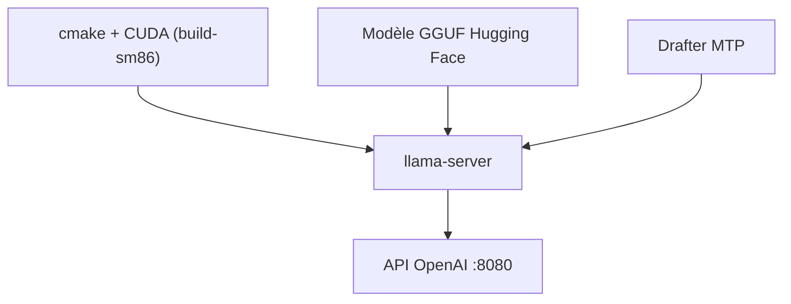

# JakeATX/llamAmpere

> Variante de llama.cpp optimisée pour les cartes NVIDIA RTX 30 (Ampere), pour faire tourner des modèles Qwen3.8 en local.

## Le problème
Faire tourner de gros modèles sur une RTX 3090 en gardant une vitesse de génération et un contexte longs reste difficile avec les builds génériques.

## Ce que ça fait vraiment
Fork de `llama.cpp` avec décodage spéculatif (tête MTP, drafter DFlash2), quantification du cache KV (SJ-KVaRN) et formats de poids propres. Prend en charge Qwen3.8 27B et Flash-Next, dont les experts sont répartis entre carte et RAM. Le serveur expose une API compatible OpenAI sur `127.0.0.1:8080`. Les chiffres de vitesse sont des mesures de l'auteur ou de contributeurs, souvent sur une seule carte.

## Comment c'est branché
Schéma simplifié d'après la fiche, sans diagramme fourni.



## Essayer
```bash
git clone -b v0.6.4 https://github.com/JakeATX/llamAmpere.git
cd llamAmpere
cmake -S . -B build-sm86 -DCMAKE_BUILD_TYPE=Release -DGGML_CUDA=ON -DCMAKE_CUDA_ARCHITECTURES=86 -DLLAMA_BUILD_BORINGSSL=ON
cmake --build build-sm86 -j8 --target llama-server
```

## Coût et pièges
Toolkit CUDA 12+, CMake et un compilateur C++ ; le modèle Flash-Next pèse 81,63 Go et demande beaucoup de RAM système. Flash-Next ne se répartit pas sur deux cartes. Le support Windows est issu de contributions non testées par l'auteur.

## Ce que ce n'est pas
Pas un llama.cpp officiel : c'est un fork centré sur Ampere et Qwen3.8. Les cartes 12 et 16 Go natives ne sont pas mesurées.

## Alternatives
llama.cpp : le projet amont, dont le README est repris dans `docs/llama.cpp-upstream-README.md`.

## Pour toi
À surveiller : utile si tu as une RTX 3090 et veux de l'inférence locale rapide, mais expérimental et porté par une personne.

