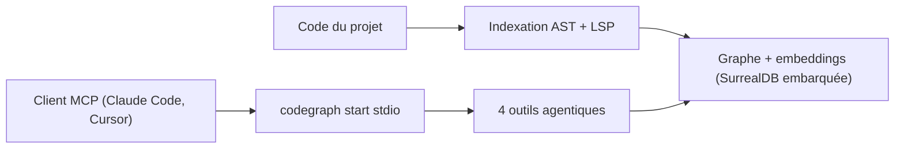

# Jakedismo/codegraph-rust

> Rust MCP server that indexes code into a knowledge graph for coding agents.

## The problem
A coding assistant reads files one by one and greps through the tree, which consumes context and starts from scratch in every conversation.

## What it actually does
CodeGraph indexes the project (AST, LSP resolution, enrichment, graph plus embeddings) and exposes four agentic tools: context, impact, architecture, quality. Search blends 70% vector and 30% lexical, with optional reranking. Three indexing tiers (`fast`, `balanced`, `full`), an embedded SurrealDB database per project, and ReAct, LATS or Reflexion agents.

## How it is wired
Simplified diagram based on the sheet, no diagram provided.


## Trying it
```bash
git clone https://github.com/Jakedismo/codegraph-rust
cd codegraph-rust
./install-codegraph-full-features.sh
codegraph init /path/to/project
codegraph index /path/to/project --index-tier balanced
./codegraph start stdio
```

## Cost and gotchas
You need an embedding model (Ollama, LM Studio, Jina, OpenAI, ONNX) and an agent LLM, often with an API key. The `balanced` and `full` tiers require language servers (rust-analyzer, gopls, clangd, etc.). Only one process can open a project's database at a time. LATS mode costs more than ReAct.

## What it is not
It is not a simple search engine: each tool launches an agent that calls an LLM, hence cost and latency. The advertised gains are not quantified in this README (answer accuracy is evaluated separately). No license is declared.

## Alternatives
No alternative named in the README.

## For you
Worth watching: the idea of a code graph served over MCP interests you for coding agents, but the absence of a license blocks any serious use until it is clarified.
