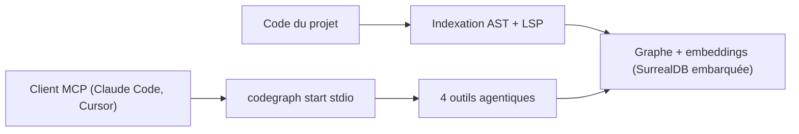

# Jakedismo/codegraph-rust

> Serveur MCP en Rust qui indexe du code dans un graphe de connaissances pour les agents de code.

## Le problème
Un assistant de code lit les fichiers un à un et grep dans l'arborescence, ce qui consomme du contexte et repart de zéro à chaque conversation.

## Ce que ça fait vraiment
CodeGraph indexe le projet (AST, résolution LSP, enrichissement, graphe plus embeddings) et expose quatre outils agentiques : contexte, impact, architecture, qualité. La recherche mélange 70 % vectoriel et 30 % lexical, avec reranking facultatif. Trois niveaux d'indexation (`fast`, `balanced`, `full`), une base SurrealDB embarquée par projet, et des agents ReAct, LATS ou Reflexion.

## Comment c'est branché
Schéma simplifié d'après la fiche, sans diagramme fourni.


## Essayer
```bash
git clone https://github.com/Jakedismo/codegraph-rust
cd codegraph-rust
./install-codegraph-full-features.sh
codegraph init /path/to/project
codegraph index /path/to/project --index-tier balanced
./codegraph start stdio
```

## Coût et pièges
Il faut un modèle d'embedding (Ollama, LM Studio, Jina, OpenAI, ONNX) et un LLM d'agent, souvent à clé d'API. Les niveaux `balanced` et `full` exigent des serveurs de langage (rust-analyzer, gopls, clangd, etc.). Un seul processus peut ouvrir la base d'un projet à la fois. Le mode LATS coûte plus cher que ReAct.

## Ce que ce n'est pas
Ce n'est pas un simple moteur de recherche : chaque outil lance un agent qui appelle un LLM, donc coût et latence. Les gains annoncés ne sont pas chiffrés dans ce README (précision de réponse évaluée à part). Aucune licence n'est déclarée.

## Alternatives
Aucune alternative nommée dans le README.

## Pour toi
À surveiller : l'idée d'un graphe de code servi en MCP t'intéresse pour des agents de code, mais l'absence de licence bloque tout usage sérieux tant qu'elle n'est pas précisée.

