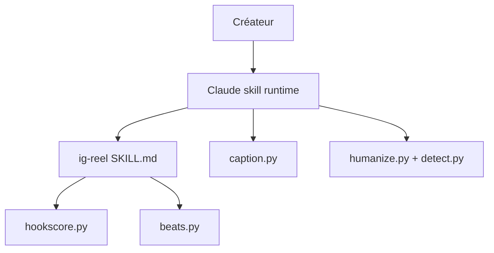

# Jakeschincariol/instagram-agent-skill

> Thirteen Claude skills for writing Instagram Reels, captions and schedules, without publishing for you.

## The problem
Producing regular, readable Instagram content takes writing, analysis and a human tone.

## What it actually does
Each skill produces a draft: Reel (26 scored hook formulas), caption with a preview of the first 125 characters, carousel, story, profile scored out of 100, weekly plan, DM. Five local Python scripts (hookscore, beats, caption, humanize, detect) with no dependencies and no network. The author publishes their measurements: AUC 0.83 against bad hooks, 0.56 for predicting winners.

## How it is wired


## Trying it
```bash
git clone https://github.com/Jakeschincariol/instagram-agent-skill.git
cp -r instagram-agent-skill/skills/ig-* ~/.claude/skills/
python3 hookscore.py hooks.txt
```

## Cost and gotchas
Free, no API key. You must fill in templates/voice.md. The scripts only run with Claude Code. Platform figures go stale quickly.

## What it is not
Does not publish anything, does not scrape, and does not claim to bypass AI detectors. The scorer weeds out bad hooks but does not predict winners.

## Alternatives
- linkedin-agent-skill: same idea for LinkedIn.

## For you
Ignore: outside your field; only the honest evaluation method (measured corpus, written limits) is worth copying.
