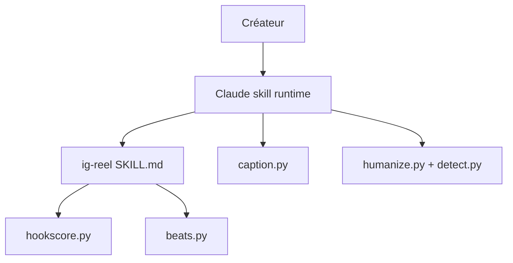

# Jakeschincariol/instagram-agent-skill

> Treize skills Claude pour écrire Reels, légendes et plannings Instagram, sans publier à ta place.

## Le problème
Produire du contenu Instagram régulier et lisible demande de l'écriture, de l'analyse et un ton humain.

## Ce que ça fait vraiment
Chaque skill produit un brouillon : Reel (26 formules d'accroche notées), légende avec aperçu des 125 premiers caractères, carrousel, story, profil noté sur 100, plan hebdomadaire, DM. Cinq scripts Python locaux (hookscore, beats, caption, humanize, detect) sans dépendance ni réseau. L'auteur publie ses mesures : AUC 0,83 contre les mauvaises accroches, 0,56 pour prédire les gagnantes.

## Comment c'est branché


## Essayer
```bash
git clone https://github.com/Jakeschincariol/instagram-agent-skill.git
cp -r instagram-agent-skill/skills/ig-* ~/.claude/skills/
python3 hookscore.py hooks.txt
```

## Coût et pièges
Gratuit, sans clé d'API. Il faut renseigner templates/voice.md. Les scripts ne tournent qu'avec Claude Code. Les chiffres de plateforme vieillissent vite.

## Ce que ce n'est pas
Ne publie rien, ne scrape pas, et ne prétend pas contourner les détecteurs d'IA. Le scoreur élimine les mauvaises accroches mais ne prédit pas les gagnantes.

## Alternatives
- linkedin-agent-skill : même idée pour LinkedIn.

## Pour toi
À ignorer : hors de ton champ ; seule la méthode d'évaluation honnête (corpus mesuré, limites écrites) mérite d'être copiée.

