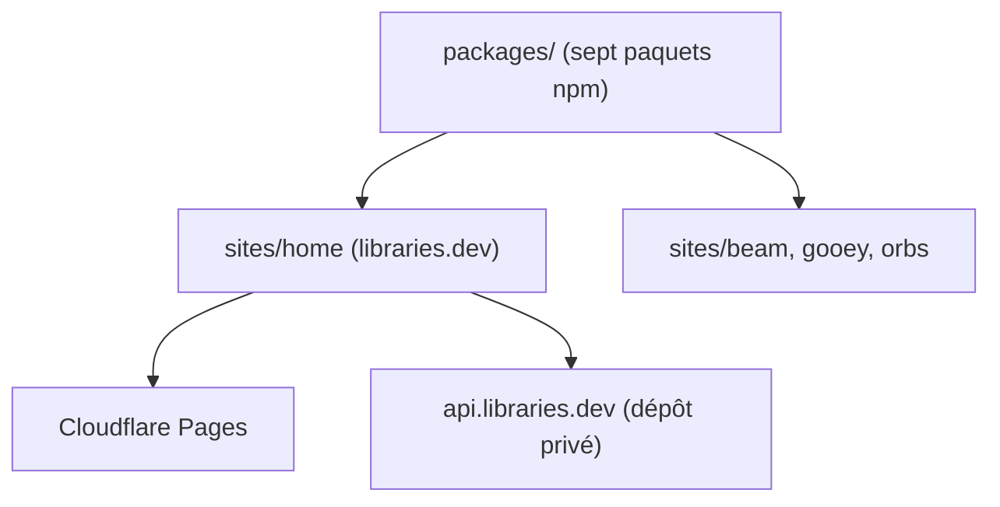

# Jakubantalik/Libraries.dev

> Seven React components for visual effects (glowing border, orbs, avatars) for AI agent interfaces.

## The problem
Agent chat and loading interfaces feel static; rebuilding WebGL or CSS effects by hand takes time.

## What it actually does
The README is identical to that of Jakubantalik/Libraries (same catalogue, dates and stars): seven independent npm packages, each wrapping a React element and configured through props. A Pro offer adds a tuning Studio.

## How it is wired
Simplified diagram based on the sheet, no diagram provided.



## Trying it
```bash
npm install border-beam   # or thinking-orbs, bot-avatars, liquid-gooey, voice-glow, metal-fx, img-fx
npm install
npm run build:site-home
```

## Cost and gotchas
Free MIT components; Studio and Pro presets are paid. Template files are under a custom license, paid for commercial use.

## What it is not
Not a separate repository: it points to the same project as Jakubantalik/Libraries, under another name. No link with data or MLOps.

## Alternatives
No alternative named in the README.

## For you
Ignore: a duplicate of the Libraries repo, and mere interface effects of no interest for a data / AI / MLOps profile.
