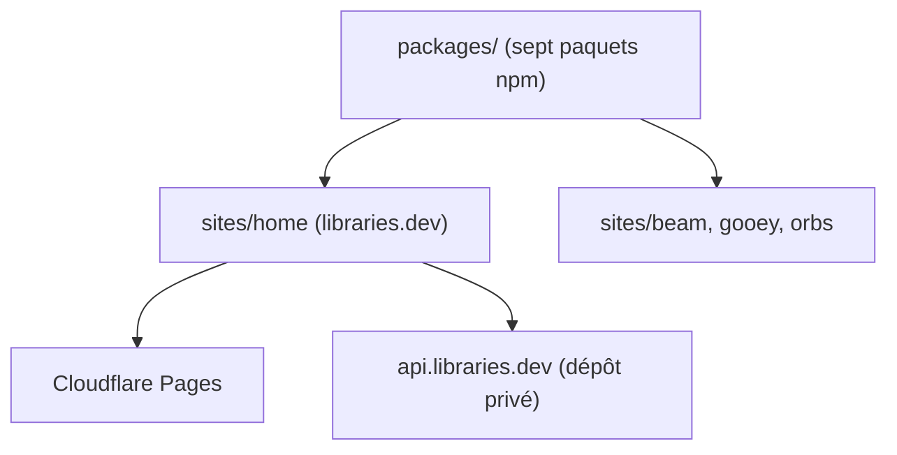

# Jakubantalik/Libraries.dev

> Sept composants React d'effets visuels (bordure lumineuse, orbes, avatars) pour interfaces d'agents IA.

## Le problème
Les interfaces de chat et de chargement d'agents paraissent figées ; refaire des effets WebGL ou CSS à la main prend du temps.

## Ce que ça fait vraiment
Le README est identique à celui de Jakubantalik/Libraries (mêmes catalogue, dates et étoiles) : sept paquets npm indépendants dont chacun enveloppe un élément React et se règle par props. Une offre Pro ajoute un Studio de réglage.

## Comment c'est branché
Schéma simplifié d'après la fiche, sans diagramme fourni.



## Essayer
```bash
npm install border-beam   # or thinking-orbs, bot-avatars, liquid-gooey, voice-glow, metal-fx, img-fx
npm install
npm run build:site-home
```

## Coût et pièges
Composants MIT gratuits ; Studio et préréglages Pro payants. Fichiers de modèles sous licence maison, payante en usage commercial.

## Ce que ce n'est pas
Pas un dépôt distinct : il pointe vers le même projet que Jakubantalik/Libraries, sous un autre nom. Aucun lien avec la data ou le MLOps.

## Alternatives
Aucune alternative nommée dans le README.

## Pour toi
À ignorer : doublon du dépôt Libraries, et de simples effets d'interface sans intérêt pour un profil data / IA / MLOps.

