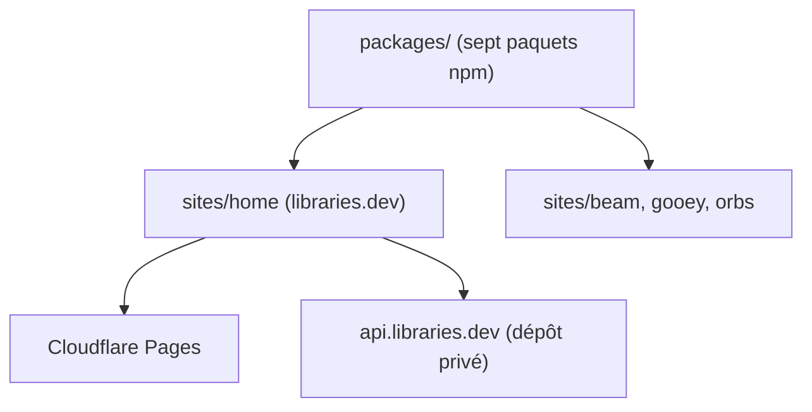

# Jakubantalik/Libraries

> Seven React components for visual effects (glowing border, orbs, avatars) for AI agent interfaces.

## The problem
Agent chat and loading interfaces feel static; rebuilding WebGL or CSS effects by hand takes time.

## What it actually does
Seven independent npm packages (border-beam, thinking-orbs, bot-avatars, liquid-gooey, voice-glow, metal-fx, img-fx), each a component that wraps an existing element and is configured through props. React 18 minimum; img-fx requires `three`. A Pro offer unlocks a tuning Studio and presets.

## How it is wired
Simplified diagram based on the sheet, no diagram provided.



## Trying it
```bash
npm install border-beam   # or thinking-orbs, bot-avatars, liquid-gooey, voice-glow, metal-fx, img-fx
npm install
npm run build:site-home
npm run dev -w @sites/home
```

## Cost and gotchas
Libraries are MIT and free; the Studio and Pro presets are paid. Template files (Magnet.mfxl) are under a custom license: paid commercial license beyond prototypes.

## What it is not
Nothing to do with data or MLOps: interface decoration. The repo is not the all-in-one library: each effect has its own package.

## Alternatives
No alternative named in the README.

## For you
Ignore for a data / AI / MLOps profile: these are React graphic effects unrelated to models, useful only if you build a chat interface.
