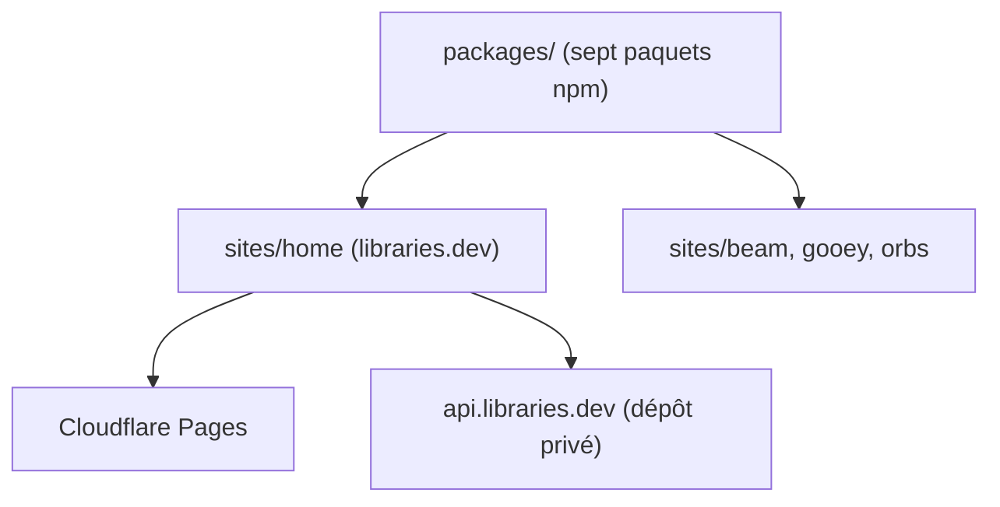

# Jakubantalik/Libraries

> Sept composants React d'effets visuels (bordure lumineuse, orbes, avatars) pour interfaces d'agents IA.

## Le problème
Les interfaces de chat et de chargement d'agents paraissent figées ; refaire des effets WebGL ou CSS à la main prend du temps.

## Ce que ça fait vraiment
Sept paquets npm indépendants (border-beam, thinking-orbs, bot-avatars, liquid-gooey, voice-glow, metal-fx, img-fx), chacun un composant qui enveloppe un élément existant et se règle par props. React 18 minimum ; img-fx demande `three`. Une offre Pro débloque un Studio de réglage et des préréglages.

## Comment c'est branché
Schéma simplifié d'après la fiche, sans diagramme fourni.



## Essayer
```bash
npm install border-beam   # or thinking-orbs, bot-avatars, liquid-gooey, voice-glow, metal-fx, img-fx
npm install
npm run build:site-home
npm run dev -w @sites/home
```

## Coût et pièges
Bibliothèques MIT et gratuites ; le Studio et les préréglages Pro sont payants. Les fichiers de modèles (Magnet.mfxl) sont sous une licence maison : commerciale payante hors prototypes.

## Ce que ce n'est pas
Rien à voir avec de la data ou du MLOps : du décor d'interface. Le dépôt n'est pas la bibliothèque tout-en-un : chaque effet a son paquet.

## Alternatives
Aucune alternative nommée dans le README.

## Pour toi
À ignorer pour un profil data / IA / MLOps : ce sont des effets graphiques React sans lien avec les modèles, utiles seulement si tu construis une interface de chat.

