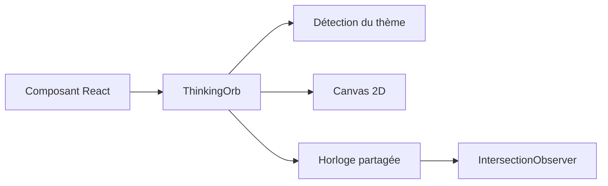

# Jakubantalik/thinking-orbs

> Loading indicators made of animated dot orbs, for AI agent interfaces in React.

## The problem
An agent that is thinking often has only a generic spinner, with no indication of what it is doing.

## What it actually does
Provides a `ThinkingOrb` React component with nine animated states (working, searching, solving, listening, connecting, weaving, composing, breathing, shaping), each in two sizes (64 and 20). Rendered on a 2D canvas, no WebGL. Light/dark theme is detected automatically. Supports `prefers-reduced-motion` and pauses when off-screen.

## How it is wired
Simplified diagram based on the fiche, no diagram provided.


## Trying it
```bash
npm install thinking-orbs
```
Then `import { ThinkingOrb } from 'thinking-orbs';` and `<ThinkingOrb state="searching" size={64} />`.

## Cost and gotchas
Free. Limited to React/TSX projects. Young project (created in July 2026), a single apparent maintainer.

## What it is not
Not an agent framework: it is a visual component that does not reflect the agent's real state; it is up to you to drive the `state` prop.

## Alternatives
No alternative named in the README.

## For you
Worth watching: nice detail for a React agent demo, but purely cosmetic for a data / MLOps profile.
