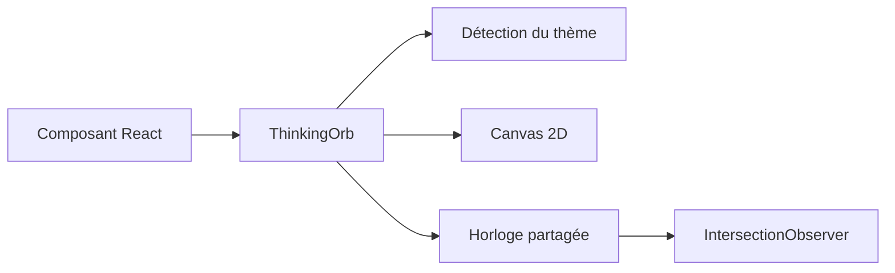

# Jakubantalik/thinking-orbs

> Indicateurs de chargement en orbes de points animés, pour interfaces d'agents IA en React.

## Le problème
Un agent qui réfléchit n'a souvent qu'un spinner générique, sans indiquer ce qu'il est en train de faire.

## Ce que ça fait vraiment
Fournit un composant React `ThinkingOrb` avec neuf états animés (working, searching, solving, listening, connecting, weaving, composing, breathing, shaping), chacun en deux tailles (64 et 20). Rendu sur un canvas 2D, sans WebGL. Le thème clair/sombre est détecté automatiquement. Supporte `prefers-reduced-motion` et se met en pause hors écran.

## Comment c'est branché
Schéma simplifié d'après la fiche, sans diagramme fourni.


## Essayer
```bash
npm install thinking-orbs
```
Puis `import { ThinkingOrb } from 'thinking-orbs';` et `<ThinkingOrb state="searching" size={64} />`.

## Coût et pièges
Gratuit. Réservé aux projets React/TSX. Projet jeune (créé en juillet 2026), un seul mainteneur apparent.

## Ce que ce n'est pas
Pas un framework d'agent : c'est un composant visuel qui ne reflète pas l'état réel de l'agent, c'est à toi de piloter la prop `state`.

## Alternatives
Aucune alternative nommée dans le README.

## Pour toi
À surveiller : joli détail pour une démo d'agent en React, mais purement cosmétique pour un profil data / MLOps.

