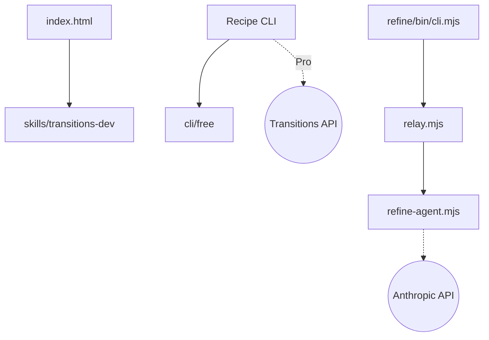

# Jakubantalik/transitions.dev

> Collection of copyable CSS transitions, with a CLI and an agent skill, for front-end developers.

## The problem
UI transitions that are generated or written by hand are often generic or inconsistent.

## What it actually does
A website presents CSS transitions (card resize, modal, menu, success, error shake…), each with a self-contained CSS snippet that includes `prefers-reduced-motion`. The `transitions-dev` CLI adds them to the project; Pro transitions require a browser login. An agent skill and a Refine tool (a local relay that injects a panel into the app) align existing animations with these tokens.

## How it is wired


## Trying it
```bash
npx transitions-dev add card-resize
npx transitions-dev list
npx skills add Jakubantalik/transitions.dev
npx transitions-refine live
python3 -m http.server 8765
```

## Cost and gotchas
Transitions are free without an account; Pro requires a login. Refine's `--llm` mode installs or wires up the Cursor CLI. A license is present but not identified by GitHub.

## What it is not
Not a component library: these are CSS recipes. Part of the content (Pro) is served by a hosted API.

## Alternatives
No alternative named in the README.

## For you
Ignore: front-end motion design, with no use in data/AI/MLOps; the license needs clarifying before any reuse.
