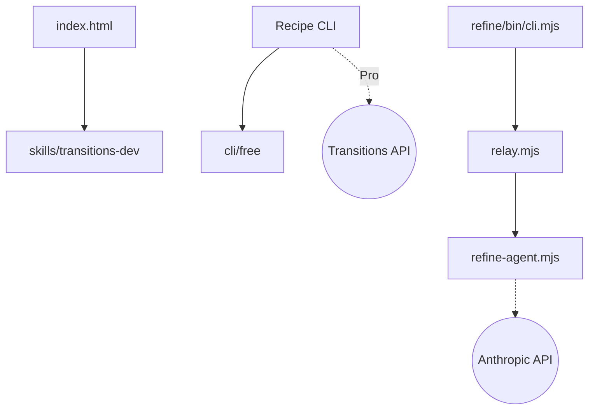

# Jakubantalik/transitions.dev

> Collection de transitions CSS copiables, avec CLI et skill d'agent, pour développeurs front.

## Le problème
Les transitions d'interface générées ou écrites à la main sont souvent génériques ou incohérentes.

## Ce que ça fait vraiment
Un site présente des transitions CSS (redimensionnement de carte, modale, menu, succès, secousse d'erreur…), chacune avec un extrait CSS autonome incluant `prefers-reduced-motion`. Le CLI `transitions-dev` les ajoute au projet ; les transitions Pro demandent une connexion navigateur. Un skill pour agents et un outil Refine (relais local qui injecte un panneau dans l'app) alignent les animations existantes sur ces tokens.

## Comment c'est branché


## Essayer
```bash
npx transitions-dev add card-resize
npx transitions-dev list
npx skills add Jakubantalik/transitions.dev
npx transitions-refine live
python3 -m http.server 8765
```

## Coût et pièges
Transitions gratuites sans compte ; Pro après connexion. Le mode `--llm` de Refine installe ou câble le CLI Cursor. Licence présente mais non identifiée par GitHub.

## Ce que ce n'est pas
Pas une bibliothèque de composants : des recettes CSS. Une partie du contenu (Pro) est servie par une API hébergée.

## Alternatives
Aucune alternative nommée dans le README.

## Pour toi
Ignorer : motion design front-end, sans usage en data/IA/MLOps ; licence à clarifier avant tout réemploi.

