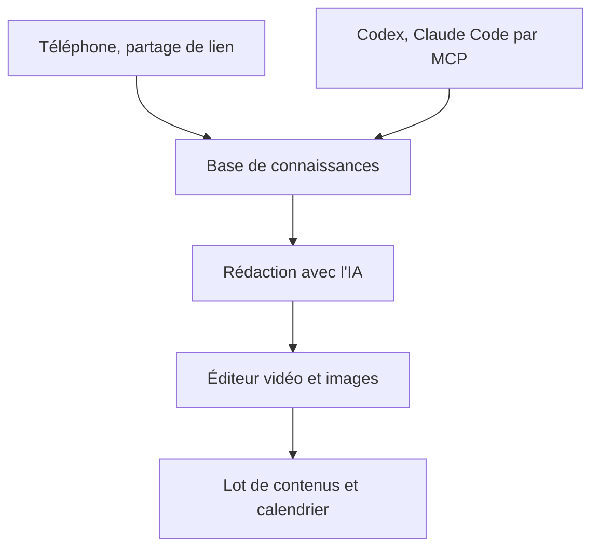

# Jamailar/Beav

> Creation workshop for social media authors: content library, AI writing, video editing.

## The problem
A content creator juggles phone, computer, editing tools and AI with no memory of their style or their account.

## What it actually does
A desktop application (Tauri and Rust) that bundles a knowledge base fed from the phone, daily reports and trend scores, account-tailored writing, image generation, a video editor with AI speech trimming, a calendar and a batch of content to publish. It connects to Codex, Claude Code or Cursor through MCP. README in Chinese.

## How it is wired
Simplified diagram based on the fiche, no diagram provided.

## Trying it
Not documented on the command line: download the installer from the download page, create a workspace, then set the model provider in Settings, AI.

## Cost and gotchas
You need either the author's official AI or your own model key. Only version 2.5.0 is open; the current product is separate and closed. MIT license limited to non-commercial use.

## What it is not
Not a mirror of the current version: the open copy is an old version. Not a free tool in the usual sense: commercial use requires the author's written agreement.

## Alternatives
None cited in the README.

## For you
Ignore: a Chinese content-creation tool, outside your domain, with a frozen open version and commercial use forbidden.
