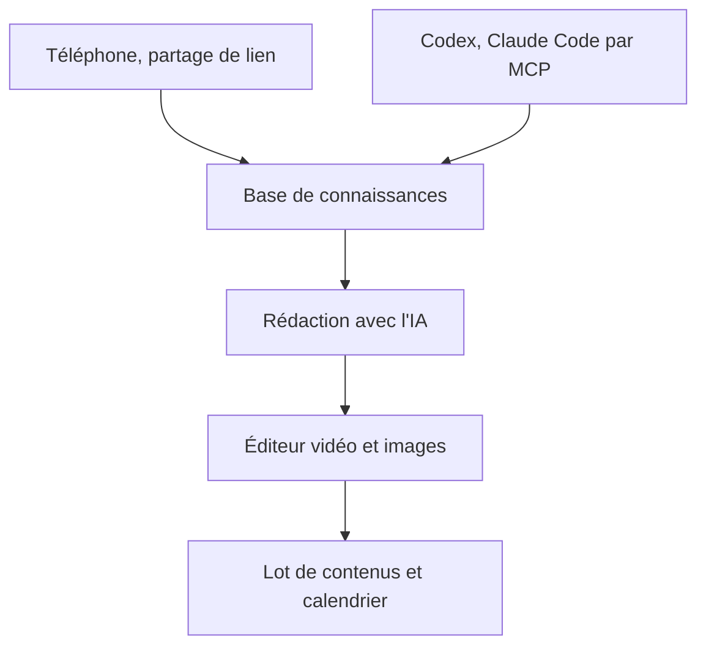

# Jamailar/Beav

> Atelier de création pour auteurs de médias sociaux : bibliothèque de contenus, rédaction par IA, montage vidéo.

## Le problème
Un créateur de contenu jongle entre téléphone, ordinateur, outils de montage et IA sans mémoire de son style ni de son compte.

## Ce que ça fait vraiment
Une application de bureau (Tauri et Rust) qui regroupe une base de connaissances alimentée depuis le téléphone, des rapports quotidiens et des scores de tendances, la rédaction adaptée au compte, la génération d'images, un éditeur vidéo avec coupe de la parole par IA, un calendrier et un lot de contenus à publier. Elle se connecte à Codex, Claude Code ou Cursor par MCP. README en chinois.

## Comment c'est branché
Schéma simplifié d'après la fiche, sans diagramme fourni.

## Essayer
Non documenté en ligne de commande : télécharger l'installateur depuis la page de téléchargement, créer un espace, puis régler le fournisseur de modèle dans Paramètres, IA.

## Coût et pièges
Il faut soit l'IA officielle de l'auteur, soit ta propre clé de modèle. Seule la version 2.5.0 est ouverte ; le produit actuel est distinct et fermé. Licence MIT limitée à un usage non commercial.

## Ce que ce n'est pas
Pas un miroir de la version actuelle : la copie ouverte est une ancienne version. Pas un outil libre au sens commun : l'usage commercial exige l'accord écrit de l'auteur.

## Alternatives
Aucune citée dans le README.

## Pour toi
À ignorer : outil de création de contenu chinois, hors de ton domaine, avec une version ouverte figée et un usage commercial interdit.

